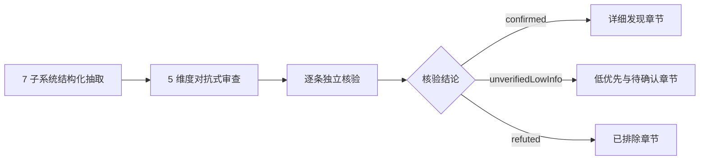
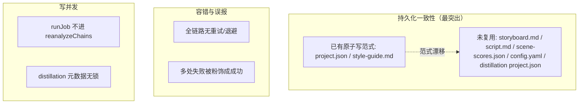

# 包拆拆（XLB Storyboard）代码审查报告

> 产品：包拆拆 / XLB Storyboard（`name=v2script`，`version=1.0.4`，`appId=com.xlbstoryboard.app`，`productName="XLB Storyboard"`）
> 定位：把视频转成「剧本」与「分镜表」的桌面工具，并支持「风格研究 / 蒸馏」（多条爆款视频 → 合成《风格指南》）。
> 技术栈：Electron 33 + electron-vite + React 18 + TailwindCSS + TypeScript；主 / preload / 渲染三进程；`ffmpeg-static`/`ffprobe-static` + `fluent-ffmpeg` 做切点检测与截图；AI 供应商 Gemini（`@google/genai`）/ Kimi / MiniMax-M3 / 自定义 OpenAI 兼容；`docx` 导出剧本、`exceljs` 导出分镜表。
> 打包：electron-builder，Windows 出 nsis 安装版 + portable 便携版，macOS 出 dmg/zip/mas。

文档版本：本次审查快照（基于仓库 `master` 分支）。本报告所有论断均以「逐条独立核验」结论为准，未独立核验或已排除的项单独列章节，避免与已确认问题混淆。

---

## 1. 审查范围与方法

### 1.1 范围

本次审查覆盖应用的全部 7 个子系统：

| # | 子系统 | 核心目录 / 文件 |
|---|--------|----------------|
| 1 | 主进程引导 / 窗口 / IPC / 任务调度 / 配置 / 路径 | `src/main/index.ts`、`src/main/job-manager.ts`、`src/main/services/{paths,config,logger}.ts` |
| 2 | 剧本生成管线（多供应商 / 流式 / 分段 / 解析 / 导出） | `src/main/services/{gemini,kimi,minimax,openai-script,prompt,script-postprocess,script-export}.ts`、`src/shared/parse-script.ts` |
| 3 | 分镜表管线 | `src/main/services/{storyboard,storyboard-analyzer,storyboard-manager,storyboard-storage,storyboard-prompt,video}.ts` |
| 4 | 风格研究 / 蒸馏管线 | `src/main/services/{distillation-manager,distillation-mosaic,distillation-storage,distillation-prompt,synthesizer}.ts` |
| 5 | 项目持久化 / 媒体导入 / 磁盘布局 | `src/main/services/{project-storage,media-import,paths}.ts` |
| 6 | 渲染层（React 页面 / 状态 / IPC 客户端 / 布局） | `src/renderer/src/**` |
| 7 | 共享契约与 preload 桥 | `src/shared/**`、`src/preload/index.ts` |

### 1.2 方法

采用多智能体并行 + 对抗式审查 + 逐条独立核验三段式：



- **5 个审查维度**：①正确性与并发 / 边界；②数据一致性与持久化；③错误处理与健壮性；④安全（Electron 桌面应用对抗式审查）；⑤跨平台与打包。
- **核验原则**：每条发现都回到源码逐处比对证据链（`file:line`），确认成立才标 `confirmed`，对原始严重度做校正（如多条从 high/critical 校正为 medium），并区分「真实可触发」与「需特定前置条件」。
- **严谨性体现**：刻意保留 1 条经核验后被**推翻**的发现（见第 5 章），说明排除理由。

---

## 2. 结论摘要

### 2.1 按严重度统计

| 类别 | High | Medium | Low | Info | 小计 |
|------|:----:|:------:|:---:|:----:|:----:|
| 已确认（confirmed） | 2 | 21 | 1 | 0 | **24** |
| 低优先 / 待确认（unverifiedLowInfo） | 0 | 0 | 12 | 2 | **14** |
| 已排除（refuted） | — | (1) | — | — | **1** |

> 已确认问题按维度分布（合计 **24**）：正确性与并发/边界 **5**（H-1、M-7~M-10）、数据一致性与持久化 **6**（M-1~M-6）、错误处理与健壮性 **7**（M-11~M-17）、安全 **4**（M-18~M-20、L-1）、跨平台与打包 **2**（H-2 `ffmpeg-static`、M-21 单实例锁）。
>
> 按严重度交叉核对：High 2（H-1 正确性 / H-2 跨平台）、Medium 21（M-1~M-21）、Low 1（L-1 安全）—— 5+6+7+4+2 = 2+21+1 = 24，自洽。

### 2.2 总体健康度判断

整体属于**功能完整、工程基础扎实，但存在一类系统性持久化与一类系统性容错缺口**的中前期产品质量：

- **没有发现会直接崩溃主进程的高频 bug，也没有可被外部远程直接利用的安全漏洞。** 多数安全条目（media://、openExternal、CSP）属于「纵深防御被削弱」，需先存在脚本注入才能被武器化。
- **最突出的系统性问题是「非原子写入」**：承载核心内容的 `storyboard.md` / `script.md` / `scene-scores.json` / `config.yaml` / distillation `project.json` 全部为裸 `fs.writeFile`，而同仓已有原子写范式（`project.json` 的 `project-storage.writeMeta`、`style-guide.md` 的 `writeStyleGuide`）却未被复用——原子保护被**选择性地遗漏在了真正重要的文件上**。崩溃 / 断电会导致配置归零或分镜数据损坏。
- **第二类系统性问题是「容错与重试缺失」**：剧本生成全链路（压缩 + 上传 + 流式，可能数分钟）对 429/5xx/连接重置无任何重试，单次抖动即整单作废；多处「失败被粉饰成成功」（Kimi 空内容、AI 解析失败伪造默认分镜、`finish_reason=length` 截断静默落盘）。
- **两个 High 仅在特定配置 / 平台触发**：合成器不剥 `<think>`（仅 MiniMax-M3 / 内联 think 的自定义供应商触发）、`ffmpeg-static` 单架构打包（仅 mac 多架构产物受损，当前主力 Windows 产物不受影响）。

建议优先级见第 6 章路线建议：**P0 集中收口「原子写 + 单实例锁」与两个 High，P1 处理容错 / 误报为成功，P2 做安全纵深加固与体验优化。**

---

## 3. 详细发现（按严重度从高到低）

> 每条包含：严重度 / 置信度 / 位置 / 证据 / 影响 / 修复建议 / 核验结论。

### 3.1 High 级

#### H-1 风格指南合成器未剥离 `<think>` 思考块，会把推理过程写入 `style-guide.md`

| 字段 | 内容 |
|------|------|
| 严重度 | **High** |
| 置信度 | High |
| 维度 | 正确性与并发/边界 |
| 位置 | `src/main/services/synthesizer.ts:128-180`（`consumeSSE`）/ `src/main/services/distillation-manager.ts:380-413` |

**证据**：`OpenAISynthesizer.consumeSSE` 只把 `json.choices[0].delta.content` 累加成 `acc` 直接返回；`GeminiSynthesizer` 同样直接累加 `chunk.text`。`distillation-manager` 把 `partial` 原样 `writeStyleGuide(distillationId, finalContent)` 落盘，中间无任何后处理。而 `resolveSynthesizerConfig`（`distillation-manager.ts:461-463`）允许 `synthesis_provider=minimax`，`minimax.ts:12-13` 明确注明「M3 是推理模型，思考内容内联在 content 里用 `<think>…</think>` 包裹（不走 reasoning_content）」。对比：剧本路径用 `stripThinkComplete`（`minimax.ts:144`、`openai-script.ts:96`），分镜分析用 `stripThink`（`storyboard-analyzer.ts:176`），**唯独合成器完全没有 strip**。

**影响**：用「风格研究 + MiniMax-M3（或其它内联 `<think>` 的自定义供应商）」时，《风格指南》开头会夹带大段思考过程。若模型在思考阶段被 `max_tokens=8192`（`synthesizer.ts:113`）截断（无 `</think>`），整份指南可能几乎全是思考内容，且 `!partial.trim()` 空检查无法拦截。

**修复建议**：
1. 最小且最稳：在 `distillation-manager` 拿到 `partial` 后、构造 `finalContent` 前做 `const cleaned = stripThinkComplete(partial)`，`!cleaned` 时抛「AI 返回空内容」。gemini 无 think，剥离无害、幂等安全，可一并覆盖三条 provider 路径。
2. 流式展示一致性：`onChunk` 透传给前端的 `partialStyleGuide` 改用 `stripThinkForDisplay(acc)`，避免用户在思考阶段看到 `<think>`，并与最终落盘一致。
3. 可选收敛：把剥离内聚进 `synthesizer.synthesize` 的返回值，让调用方拿到的就是干净文本。
4. 顺带把 `OpenAISynthesizer` 的 `max_tokens` 像剧本路径一样调高（参考 64k），减少推理被截断导致整份是思考内容的概率。

**核验结论**：成立（confidence high）。判 high 而非 critical 的依据——仅在非默认配置（`synthesis_provider` 选 MiniMax-M3 或内联 think 的自定义供应商）下触发，默认 gemini/kimi 路径不受影响，不导致崩溃 / 数据损坏，但一旦触发即明显污染交付文档。

---

#### H-2 `ffmpeg-static` 只随安装环境打入单一平台 / 架构二进制，mac 多架构 dmg/zip 必坏

| 字段 | 内容 |
|------|------|
| 严重度 | **High** |
| 置信度 | High |
| 维度 | 跨平台与打包 |
| 位置 | `package.json:58-71`（`mac.target arch ['arm64','x64']`）+ `src/main/services/video.ts:13-23` |

**证据**：`package.json` 对 mac 同时声明 arm64 与 x64。但 `ffmpeg-static` 的 `install.js` 在 `npm install` 时按 `npm_config_platform/arch || os.platform()/os.arch()` 只下载**一个**二进制，落在包根（本机仅有 `node_modules/ffmpeg-static/ffmpeg.exe` 一个文件，无 per-arch 目录；`index.js` 直接返回 `path.join(__dirname,'ffmpeg')`）。electron-builder 多 arch 构建复用同一份 `node_modules`，仓库**无 `beforePack`/`afterPack` 重装钩子**，两种架构产物会被塞进同一份 ffmpeg。对照 `ffprobe-static` 自带全平台目录（`bin/darwin/{arm64,x64}`、linux、win32），所以 `getVideoInfo` 能跑，但 `segmentVideo`/`compressIfNeeded` 调用的 ffmpeg 会失败，问题更隐蔽。

**影响**：在与构建机相反架构的 Mac 上，分段 / 压缩会 spawn 到错误架构 ffmpeg → 启动失败（ENOENT / Bad CPU type），长视频分段与上传前压缩整条链路不可用。若误在 Windows 上 `dist:mac`，mac 包里只有 `ffmpeg.exe`、无 mac ffmpeg，必崩。

**修复建议**：让 ffmpeg-static 在打包期按目标 arch 取对应二进制——加 electron-builder `beforePack`/`afterPack` 钩子，按当前 target arch 重新拉取匹配的 ffmpeg-static（设置 `npm_config_platform/npm_config_arch` 重装，或下载到 arch-specific unpacked 路径），运行时按 `process.arch` 选择；或改用像 `ffprobe-static` 那样自带全平台 + 架构二进制的方案（如 `@ffmpeg-installer/ffmpeg` 的 per-arch optional packages），保持在 `asarUnpack` 内并按 `process.platform/process.arch` 解析路径。CI 中每个 mac arch 在匹配的 runner 上构建。**在修复前：不要从 Windows 构建分发 mac dmg/zip，并把双架构 mac 目标视为已损坏。**

**核验结论**：成立（confidence high）。判 high 而非 critical——当前实际分发的产线是 Windows x64（nsis + portable），其打入的 `ffmpeg.exe` 是正确的；问题局限于已声明但无证据正在主动构建 / 发布的 mac 产物。

---

### 3.2 Medium 级

> 21 条 Medium 按维度归类呈现，便于集中修复。

#### 3.2.1 数据一致性与持久化（非原子写 / 缺锁 / 路径不可用）

> 本组 6 条是本次审查最系统性的问题：**承载内容的文件全是裸 `fs.writeFile`，而同仓已有原子写范式未被复用。**

| 编号 | 标题 | 位置 | 置信度 |
|------|------|------|:------:|
| M-1 | distillation `project.json` 非原子写，崩溃 / 断电会让整个研究项目从列表消失 | `distillation-storage.ts:84-87` | high |
| M-2 | distillation `project.json` 的 read-modify-write 缺串行锁，并发改名 / 标记会丢更新 | `distillation-storage.ts:171-234` | medium |
| M-3 | `config.yaml` 非原子写 + 解析损坏时静默回退默认值（API Key 丢失且会被覆盖） | `config.ts:74-82` | medium |
| M-4 | `storyboard.md`/`script.md`/`scene-scores.json` 非原子写，崩溃中途损坏唯一分镜数据源 | `project-storage.ts:180-215` | medium |
| M-5 | `storyboard.md` 写入非原子且多写入路径无互斥，文件截断 / 交错损坏 | `project-storage.ts:197-202` | medium |
| M-6 | `storyboard.md` 只写视频 basename，导入分镜表后新项目 `videoPath` 是文件名而非可用路径 | `storyboard-storage.ts:96-99,266-275` | high |

**M-1 详情**：`writeMeta` 直接 `fs.writeFile(getMetaPath(meta.id), JSON.stringify(meta,null,2), 'utf-8')`，无 tmp+rename。`readMeta`（75-82）一旦 `JSON.parse` 失败即 `return null`，`listDistillations`（89-103）因 `meta=null` 跳过该目录。对照 `project-storage.ts:72-80` 已用 `.tmp`+rename 并注释「避免崩溃/断电留下半截 project.json…整个项目就从列表里消失」。**写 `project.json` 过程中（create/rename/markHasStyleGuide/addVideos/touch）崩溃，重启后该研究项目连同 `videos/`、`style-guide.md` 一起从 UI 消失**（文件其实还在但不可见）。同一文件的 `writeStyleGuide`（272-281）已用原子写，作者已知该模式却未应用于 `writeMeta`。

**M-3 详情**：`saveConfig` 第 79 行 `fs.writeFile(configPath, yamlStr)` 非原子。`loadConfig`（57-70）在非 ENOENT（YAML 损坏）时 `cachedConfig = deepClone(DEFAULT_CONFIG)` 仅记日志、不备份不重存；之后用户在设置页点保存就会用默认值覆盖那份本可手工修复的损坏文件。`config.yaml` 存放 gemini/kimi/minimax/custom 的 `api_key`。**保存设置时崩溃 → 半截 YAML → 下次启动解析失败 → 所有 Key 静默归零（界面看似正常但 key 为空）→ 下次保存覆盖原文件，无法找回。**

**M-6 详情**：`buildMarkdown` 写 `> 源视频: \`${path.basename(project.videoPath)}\``（96 行）；`parseMeta`（271-273）提取出的就是 basename；`PROJECT_IMPORT_STORYBOARD`（`index.ts:625`）`createProject({name, videoPath: sbProject.videoPath})` 直接把 basename 当 videoPath 存进 `project.json`。后续 `index.ts:470/515/551` 的 `existsSync(project.videoPath)` 对裸文件名恒为假 → **导入分镜表创建的项目无法预览视频、无法补帧加镜、无法重新识别、导出时长为 0**。`storyboard-manager.ts:289-292` 注释也亲口承认「storyboard.md 里只存了视频文件名（basename），不能直接喂给 ffmpeg」。

**统一修复建议（本组通用）**：

```text
抽取共享原子写工具（参照已有 writeMeta / writeStyleGuide），放在 paths.ts 或新建 fs-atomic.ts：
  写 `${target}.tmp` → fs.rename(tmp, target)   // 同卷 rename 为原子操作
统一改造以下写入点：
  - project-storage.ts: writeScriptMd / writeStoryboardMd / writeSceneScores
  - storyboard-storage.ts: saveStoryboardProject
  - distillation-storage.ts: writeSubVideoStoryboard / writeSubMeta / writeMeta
  - config.ts: saveConfig（写 .tmp 后 rename，可选 fsync）
配套：
  - config.ts loadConfig 解析失败分支：先把损坏文件 rename 为 config.yaml.corrupt-<ts>.bak 再回退默认值；可滚动保留 config.yaml.bak 作为优先回退源
  - 引入 per-id withMetaLock（复用 project-storage 范式）覆盖 distillation 的 rename/addVideos/touch/markHasStyleGuide（M-2）
  - storyboard.md 写互斥：把 runJob 也纳入 reanalyzeChains 或独立 per-project 写锁（M-5）
  - M-6：buildMarkdown 额外写机器可读完整路径行 `> 源视频路径: \`...\``，parseMeta 优先匹配该行、退回 basename；导入时若 existsSync 失败弹 dialog 让用户另选源视频
```

**核验结论**：6 条全部成立。`writeStyleGuide`/`project.json writeMeta` 两处现成原子写范式恰好证明「同代码库已知该模式却选择性遗漏」。M-1、M-6 confidence high；其余 medium（触发需写入瞬间崩溃或导入非主流程）。

---

#### 3.2.2 正确性与并发 / 边界

| 编号 | 标题 | 位置 | 置信度 |
|------|------|------|:------:|
| M-7 | reanalyze 持起始快照写回整表，与整表重生成（runJob）并发时丢失更新 | `storyboard-manager.ts:152,211-212,445-600` | medium |
| M-8 | 分析失败的镜头 `endSec` 被写成 `t+1`，且 reanalyze 成功后仍沿用旧错误时长 | `storyboard-manager.ts:864-876,188-191` | medium |
| M-9 | 序列化按 `shot.number-1` 取 framePath，镜号非连续时关键帧与镜头错位 | `storyboard-storage.ts:122` | medium |
| M-10 | `scaleTimestamps` 仅匹配半角 `[HH:MM:SS]`，对全角【】/两段式时间戳不缩放 | `script-postprocess.ts:47,65-84` / `parse-script.ts:19-20` | low |

**M-7 详情**：`runReanalyze` 开头 `const sbProject = await readStoryboard(projectId)`（152）读一次快照，经数十秒并发 AI 识别后在 211-212 `if(updated>0) await writeStoryboardMd(projectId, sbProject)` 整表写回。reanalyze/addShot/recognize 经 `reanalyzeChains` 串行，但 `runJob`（整表重生成，由 `start()` 直接调用）只登记 `this.active`、**不进 `reanalyzeChains`**，二者可真正并发 → runJob 写出的新表被 reanalyze 用旧快照覆盖。`recognizeShotByFrame`（416-435）已专门用「识别期间重读最新分镜 + 按 framePath 重定位」规避此 lost update，但 reanalyze 没有。
> 修复：runReanalyze 写回前像 `recognizeShotByFrame` 那样重读 `fresh = await readStoryboard(projectId)`，用旧快照 `framePath` 在 `fresh.framePaths.indexOf` 重定位（不能用旧 index），仅替换该镜 AI 内容、采用 fresh 的位置元数据，再写 fresh；framePath 不存在则跳过。更彻底是把 runJob 纳入 per-project 写锁。

**M-8 详情**：成功镜用下一镜 timestamp 作 endSec（847），失败分支写死 `endSec: t+1`、`timeRange: HMS(t)-HMS(t+1)`（864-876）；reanalyze 重识别成功后显式 `shot.endSec = old.endSec`（189-191）沿用旧的 1 秒错误值，**无法自愈**。
> 修复：失败分支 endSec 取下一镜 startSec（末镜兜底 t+5）；reanalyze 批处理后调用现成的 `renumberShots` 统一按相邻镜重算 number/endSec/timeRange，既修历史遗留也能重识别后自愈。

**M-9 详情**：`buildMarkdown` 用 `project.framePaths[shot.number-1]` 取帧（依赖「number===位置+1」隐式不变量），但 `parseMarkdown` 按出现顺序 `framePaths.push`（254，positional）、number 解析自标题 `parseInt`（160）。App 自身所有写盘路径都维持该不变量（splice 后必 `renumberShots`），**正常使用不触发**；真正触发源是 `storyboard.md` 是面向用户可编辑的存储格式——用户手工删改某段 `## 镜 N` 或改镜号后重载，会得到 1,2,4,5… 而 framePaths 仍 positional → 关键帧映射错镜 / 越界丢图。
> 修复：序列化改为按循环下标取帧（`for (let i…) project.framePaths[i]`），消除对镜号连续性的依赖，与 positional 的 parseMarkdown 对齐。

**M-10 详情**：`TS_RE=/\[(\d{1,2}):(\d{2}):(\d{2})\]/g` 只认半角方括号、三段式，而 `HEADING_REGEX` 支持全角【】、圆括号、两段式 M:SS。MiniMax-M3（中文模型）/ 自定义模型若输出 `【00:02:10】` 或 `[02:10]`，`scaleTimestamps` 匹配不到 → `count=0` 原样返回（不缩放），但 `parseScript` 仍能解析出（漂移 / 超时长的）时间戳 → 缩放兜底失效。
> 修复：让 `TS_RE` 与 `HEADING_REGEX` 对齐（兼容全角 / 圆括号 / 两段式），或直接复用 `parseScript`/`parseHeading` 的解析结果计算 maxSec 与替换；缩放后用真实时长再 clamp；`count==0` 但实际解析出场景时至少打 warn。

**核验结论**：M-7/M-8/M-9 成立（medium，均需边界条件触发，但后果是可感知的数据错位 / 丢失）；M-10 成立但 confidence low——默认 prompt 要求半角 `[HH:MM:SS]`，仅在模型偏离 prompt 时暴露，属兜底缺口而非主路径必现。

---

#### 3.2.3 错误处理与健壮性

| 编号 | 标题 | 位置 | 置信度 |
|------|------|------|:------:|
| M-11 | Kimi 流在 `[DONE]` 且无内容时静默返回空串，空剧本被当成功落盘 | `kimi.ts:335-339,372-375` / `job-manager.ts:298-321` | high |
| M-12 | 生成被截断（`finish_reason=length`）但非空时静默落盘为完整剧本 | `minimax.ts:144-149` / `openai-script.ts:96-100` / `kimi.ts:315,377` | medium |
| M-13 | AI 返回无法解析为 JSON 时伪造默认分镜（近景 / 平视角 / 静态镜头），把失败粉饰成成功 | `storyboard-analyzer.ts:174-205` | medium |
| M-14 | 时间戳等比缩放被单个离群 / 幻觉时间戳整体压缩，污染全片时间轴 | `script-postprocess.ts:65-83` | medium |
| M-15 | 整段剧本生成（上传 + 流式）对瞬时网络 / 5xx/429 无任何重试，单次抖动即长任务全废 | `kimi.ts` / `minimax.ts` / `openai-script.ts` / `gemini.ts` | medium |
| M-16 | `waitForFileActive` 对 PROCESSING 无限轮询、无超时；单次 `files.get` 瞬时错误即整单失败 | `gemini.ts:271-282` | medium |
| M-17 | `getDuration` 缺 `'error'` 事件处理，且解析失败返回 0 导致整片退化为单一分镜 | `storyboard.ts:309-323,136-153` | medium |

**M-11 详情**：`streamChat` 收到 `[DONE]` 直接 `return acc`（仅 `!acc.trim()` 时记 error 日志，不抛）；末尾的 `throw new Error('Kimi 返回了空内容')`（372）只在「没发 [DONE] 就 done」时才可达，对 Kimi 正常终止是死代码。`generateScript`（128）与 `job-manager` 拿到结果均无空判断，直接 `parseScript`+`writeScriptMd`+`send('completed')`。对比 Gemini/MiniMax/自定义都有空内容保护，唯独 Kimi 的 [DONE] 路径漏了。**内容过滤 / 空 delta + [DONE] 时（触发安全策略、模型异常会发生）→ 用户得到空白剧本，界面显示「完成」并落盘，无任何报错。**
> 修复：kimi.ts DONE 分支（~337）对空 acc 抛错；job-manager 在 `parseScript`/`writeScriptMd` 前加 blank-script guard。

**M-13 详情**：`JSON.parse` 与正则 `cleaned.match(/\{[\s\S]*\}/)` 都失败时，`parsed` 仍为 `{}`，函数照常返回 `{shotType:'近景', angle:'平视角', cameraMove:'静态镜头', description: cleaned.slice(0,200), …}` 不抛错。上层 `storyboard-manager`（403-411/864-873）有「分析失败」分支（写 `description='分析失败: …'`，前端据此识别失败态），但因 `parseResponse` 静默兜底而非抛错 → 失败镜头永远走不到该分支。
> 修复：`parseResponse` 区分「解析成功但字段缺失」与「彻底无法解析」——两次 JSON 解析都失败时 `throw new Error('AI 返回无法解析为 JSON: …')`，交由上层 catch 落成失败占位镜；仅在完全无结构化结果时抛，保留部分字段缺失的 `||` 兜底。

**M-14 详情**：`factor = durationSec / maxSec`，缩放因子由全文最大时间戳单点决定。模型只要幻觉出一个 `[99:00:00]`，factor 极小 → 整份剧本所有正常时间戳被压扁。第 78 行的 `maxSec<=durationSec+1` 守卫反而被离群点拉高、更易进入缩放分支，即「漂移越严重缩得越狠」。
> 修复：用稳健统计——剔除 `tsToSec > durationSec*K`（K≈1.5~2）的离群点，或取 P95/P98 分位作 maxRef；factor 设下限；缩放结果校验单调非降且不超 durationSec，超界 clamp。

**M-15 详情**：所有上传与 `streamChat` 的 fetch 在 `!resp.ok` 时直接 throw，流读取异常直接冒泡，全仓 `grep retry|backoff` 零命中。长视频先压缩 + 上传（数十 MB / 数分钟）再流式生成，过程中任一 429/502/连接重置都让整单从头失败，重复上传 / 计费。
> 修复：对幂等阶段加有限次（2~3）指数退避，触发限定 429/5xx + 网络类错误、尊重 `Retry-After`、abort 不重试；流式阶段拿到 file_id 后中断只重试 chat（缓存 file_id，不重新压缩上传）；抽 `fetchWithRetry`/`withBackoff` 工具集中实现。

**M-17 详情**：`getDuration` 的 spawn 只挂 `child.on('close')`，没挂 `child.on('error')`（同文件 `collectScenePoints:268` 已挂，属遗漏）；close 里正则匹配不到 Duration 时 `resolve(0)`。`postProcessShots` 在 shots<2 时 `interval=duration/count`，duration=0 → 循环不成立 → 只返回 `[{timestamp:0,score:0}]`。**①ffmpeg spawn 失败时无监听 'error' 抛未捕获异常（潜在主进程崩溃）；②容器损坏 / 解析不出时长时整段退化为 1 个分镜，用户得到几乎空的分镜表却无报错。**
> 修复：给 child 加 `child.on('error', reject)`；fallback 优先复用上游 `getVideoInfo()` 的 durationSec 而非再 spawn；`duration<=0` 时抛可读错误或固定间隔采样并告警，对 0/NaN 做防御。

**核验结论**：本组全部成立。M-11 confidence high（其它 provider 都有保护、唯独 Kimi [DONE] 路径漏，会静默产出空文件并报成功）；其余 medium——均为「失败被粉饰成成功 / 长任务无容错」的健壮性缺陷，非崩溃 / 安全，但用户可感知。

---

#### 3.2.4 安全（Electron 对抗式审查）

| 编号 | 标题 | 位置 | 置信度 |
|------|------|------|:------:|
| M-18 | API Key 以明文 YAML 落盘，未做任何加密 / OS 凭据库保护 | `config.ts:74-80,43-45` | high |
| M-19 | `media://` 协议无路径白名单，渲染进程可构造任意绝对路径读取磁盘任意文件 | `index.ts:110-182` / `preload/index.ts:32` | high |
| M-20 | `shell.openExternal` 直接转发渲染进程任意 URL，无协议白名单 | `index.ts:380-382` | medium |

**M-18 详情**：`saveConfig` 直接 `yaml.dump(merged)` 写盘，`merged` 含 gemini/kimi/minimax/custom 的 `api_key`，全仓无 `safeStorage` 调用。config 路径在 portable 形态下落在 `<exe>/XLB Storyboard/config.yaml`（与绿色目录同级，易被网盘同步 / 随包拷贝 / 被同机其它进程读取）。**任何能读到该文件的本地进程、备份、云同步即可窃取密钥，导致第三方 API 账号被盗刷。**
> 修复：写盘前对所有 api_key 用 Electron `safeStorage.encryptString()`（Windows DPAPI / macOS Keychain）存为带 `enc:` 前缀的 base64，读时 `decryptString` 还原到内存；先 `isEncryptionAvailable()` 判断；旧明文按无前缀识别、下次保存改写为密文实现平滑迁移。注意 safeStorage 仅 app ready 后可用。
> 严重度说明：判 medium——攻击前提是攻击者已能读取该用户本地文件，非远程可利用；DPAPI 只能防「文件被搬到其它机器 / 用户上下文」，无法防同账户恶意进程。

**M-19 详情**：协议处理器把 URL path 的 base64 解码为绝对路径后直接 `createReadStream(absPath)`，响应头固定 `Access-Control-Allow-Origin: '*'`，无任何「必须位于项目 / 数据目录」的归一化与前缀校验。preload 把 `getMediaUrl(absPath)` 直接暴露给 `window.v2s`，渲染进程无需 IPC 即可凭任意路径生成 `media://local/<base64>` 并 fetch。**media 通道等价于对当前 OS 用户可读文件的无限制读盘原语（config.yaml 明文密钥、用户文档、.ssh 等）；一旦渲染进程被注入脚本即可读取任意本地文件。**
> 修复：处理器入口对解码路径 `path.resolve` 归一化后做根集合校验（数据根 / 当前项目目录 / 用户经 dialog 选中的白名单 Set），用 `path.relative(root, resolved)` 不以 `..` 开头判定（避免 `startsWith` 前缀混淆）；去掉 `*` CORS 头；更稳妥是主进程下发一次性 token 映射已授权路径，渲染进程拿 token 而非裸路径。

**M-20 详情**：`shell.openExternal(url)` 对 url 不做任何 scheme/host 校验。当前唯一调用方虽是硬编码小红书链接（`SettingsModal.tsx:809`），但 IPC 入口对任意调用方开放。`openExternal` 可触发 `file:`、`ms-msdt:` 等非 http(s) 协议，在 Windows 上被用来拉起本地程序 / 协议处理器。
> 修复：`new URL(url)` 后仅允许 `https:`（必要时 `http:`），其余 scheme 拒绝并记日志；进一步收紧为 host 白名单（xhslink.com / xiaohongshu.com）；在 BrowserWindow 上设 `setWindowOpenHandler`/`will-navigate` 兜底。

**核验结论**：3 条全部成立。M-18/M-19 confidence high（缺陷确实存在），但严重度均判 medium——属纵深防御被削弱，需先存在脚本注入（XSS）才能武器化，非可直接外部利用。

---

#### 3.2.5 跨平台与打包

| 编号 | 标题 | 位置 | 置信度 |
|------|------|------|:------:|
| M-21 | 缺少单实例锁，便携版多开会并发读写同一 `config.yaml`/数据目录导致配置与项目损坏 | `index.ts:727`（全文件无 `requestSingleInstanceLock`） | high |

**M-21 详情**：全仓 `grep requestSingleInstanceLock|second-instance` 无匹配。便携版数据根 `<exe>/XLB Storyboard/data`，`config.yaml` 在其父目录；`saveConfig` 直接 `fs.writeFile`，各 manager 还会并发写项目目录。**双击多开 / 便携版被多窗口同时运行时，两进程对同一 `config.yaml` 与项目文件并发写，后写覆盖先写（API Key / 项目数据丢失），便携场景（U 盘 / 共享目录）尤其常见。**
> 修复：在 `app.whenReady()` 之前加单实例守卫：
> ```js
> const gotLock = app.requestSingleInstanceLock()
> if (!gotLock) { app.quit(); return }   // return 阻止后续 whenReady 链
> app.on('second-instance', () => {
>   const w = BrowserWindow.getAllWindows()[0]
>   if (w) { if (w.isMinimized()) w.restore(); w.focus() }
> })
> ```
> 配套把 `saveConfig` 改原子写（与 M-3 同）。注意单实例锁默认按 userData 区分，便携版若要按数据目录粒度隔离不同位置 exe，可在锁前 `app.setPath('userData', …)` 或用基于 `getDataRoot()` 的锁文件做二级校验。

**核验结论**：成立（confidence high）。判 medium——需用户实际多开才触发，正常单开不受影响，但确为真实数据丢失风险。

---

### 3.3 Low 级

#### L-1 CSP 允许 `script-src 'unsafe-inline'` 与 `'unsafe-eval'`，削弱 XSS 纵深防御

| 字段 | 内容 |
|------|------|
| 严重度 | **Low** |
| 置信度 | Medium |
| 维度 | 安全 |
| 位置 | `src/renderer/index.html:7-9` |

**证据**：`script-src 'self' 'unsafe-eval' 'unsafe-inline'`，且全仓无运行时 `onHeadersReceived` 下发 CSP，这条宽松 meta CSP 是唯一来源。已开启 `contextIsolation:true`、`nodeIntegration:false`、`webSecurity:true`。**经核验：全仓无任何 `dangerouslySetInnerHTML`/`innerHTML`，也未引入 react-markdown/marked 等把第三方文本转 HTML 的库**——AI 返回文本作为 React 文本子节点渲染默认转义，media:// 经 `src` 属性加载不构成脚本执行路径。因此当前不存在可触发的注入 sink。

**影响**：纵深防御性质。若将来引入 markdown 渲染或 `dangerouslySetInnerHTML` 而 CSP 不收紧，注入脚本可直接执行并驱动 M-19/M-20 暴露的能力。

**修复建议**：作为加固项——生产构建移除 `'unsafe-eval'`（Vite 产物通常不需要）并验证；内联脚本 / 样式改用 nonce/hash；推荐改为运行时 `session.defaultSession.webRequest.onHeadersReceived` 下发 CSP（区分 dev 宽松 / prod 收紧）；建立硬性规则：渲染 AI 返回内容禁用 `dangerouslySetInnerHTML`，需渲染 markdown 必须经 DOMPurify 净化。

**核验结论**：事实成立但影响被高估——因无现存注入 sink + 已有 contextIsolation，实际风险为纵深防御缺口，定 low 而非 high。

---

## 4. 低优先与待确认项（unverifiedLowInfo）

> 以下条目未做与第 3 章同强度的独立核验，多为局部健壮性 / 边界 / 隐私边界问题，建议在相应模块迭代时顺手处理。

| 编号 | 标题 | 严重度 | 位置 |
|------|------|:------:|------|
| U-1 | `parseScript` 把正文中以时间样式开头的行误判为新场景头部 | low | `parse-script.ts:19-20,83-107` |
| U-2 | distillation 子视频失败时把 `subProgress` 重置为 0，整体进度回退（与「进度不倒退」注释矛盾） | low | `distillation-manager.ts:143-144,264-279` |
| U-3 | 沙盒导入用「文件名 + 体积相同」判重，可能把两个不同视频误判为同一文件而复用错误副本 | low | `media-import.ts:48-53` |
| U-4 | 分镜表 XLSX 的「时长」按下一镜起点重算并对缺失视频回退 0，末镜时长可能为 `00:00:00` | low | `storyboard.ts:388-390` |
| U-5 | 多个文件 IPC 处理器接受渲染进程任意路径，无归一化 / 边界校验（混淆代理） | low | `index.ts:334-337,315-318,384-386` |
| U-6 | 主窗口缺少导航与 `window.open` 拦截（`will-navigate`/`setWindowOpenHandler`） | low | `index.ts:69-104` |
| U-7 | 视频 / 帧外发第三方 AI 缺少明确告知与最小化，且远端留存（MiniMax file_id 7 天） | info | `minimax.ts:187-258` / `gemini.ts:217-269` |
| U-8 | `extractFrame` 不校验截图是否真正产出，缺帧延后到 `readFile` 才失败 | low | `storyboard.ts:326-342` |
| U-9 | 风格研究整体进度在子视频失败时倒退（与 U-2 同源） | low | `distillation-manager.ts:268-270,246` |
| U-10 | 全局代理仅按 Google 可达性决定却作用于所有供应商，可能把国内 API 强行走境外代理 | low | `gemini.ts:360-376,383` |
| U-11 | `getVideoInfo` 对 `parsed.format.format_name` 未做可选链，format 缺失时抛不可读 TypeError | low | `video.ts:93 vs 102` |
| U-12 | 流式读取无显式超时 / 空闲死线，挂死流只能靠用户手动取消 | low | `kimi.ts:318-320` 等 4 处 |
| U-13 | `config.yaml` 非原子写入（与已确认 M-3 同源，置于跨平台维度的重复观测） | low | `config.ts:74-82` |
| U-14 | `asarUnpack` 会把 ~82MB 的 `ffmpeg.exe`（GPL-3.0）原样分发，缺少 GPL 源码提供声明 | info | `package.json:28-31` |

要点提示：
- **U-7 / U-14 是合规 / 隐私边界**，非技术 bug，但对商业分发有现实意义：U-14 需在安装包 / 关于页随附 ffmpeg 的 GPL 许可证与「对应源码获取方式」，或改用 LGPL 构建；U-7 建议上传前 UI 明确告知留存时长并取得同意、自定义供应商强制 https。
- **U-5 / U-6 与已确认的 M-19/M-20 同属「任意路径 / 导航」攻击面**，建议在做 M-19 的路径白名单时一并收口。
- **U-10 是真实可感知的体验坑**：用户为 Gemini 配代理后，Kimi/MiniMax 等国内端点也被强制走境外代理，错误表象与代理无关、难排查。建议按目标 host 决定是否走代理。

---

## 5. 已排除项（refuted）

> 保留并说明排除理由，体现审查严谨性——并非所有「看似问题」的发现都成立。

#### R-1（已排除）MAS 沙盒：跨会话重访已保存视频绝对路径会被沙盒拒绝（缺 security-scoped 书签）

- **原始判断**：`entitlements.mas.plist` 仅有 `files.user-selected.read-write`，无 `bookmarks.app-scope`；媒体协议与 `getVideoInfo` 重开项目时访问持久化的 `project.videoPath`，沙盒下 user-selected 授权仅限当次拾取会话，重启后对老路径无访问权 → MAS 构建重开项目时视频预览 / 导出失败。
- **排除理由**：核心技术前提不成立。`createProject`（`project-storage.ts:144`）创建项目时调用 `importMediaToContainer(args.videoPath, getProjectDir(id))`；该函数（`media-import.ts:20-33`）在 `isSandboxed()`（`process.mas===true`）为真时**把用户选择的源视频拷贝进项目目录并返回容器内路径**，存档的 `videoPath` 因此指向容器副本（非沙盒构建才原样返回外部路径）。项目目录在 macOS 打包 / MAS 下位于 `userData/data/projects/<id>/`，即 App 自有沙盒容器内，容器内文件在 App Sandbox 下永远可访问，无需任何 bookmark。重开项目时 `getVideoInfo` 与 `media://` 的 `createReadStream` 都作用在容器副本上，不会失败。`media-import.ts` 文件头注释也明确「跨会话重读都走容器内副本」。审查者遗漏了这条已有缓解，故所提 bookmark + entitlement 修复对当前设计是多余的。
- **附注**：发现中附带的「ffmpeg-static GPL 与 App Store 条款不兼容」属另一类合规问题（参见 U-14），与本条所述技术缺陷无关，且 ffmpeg 二进制已签名继承沙盒，不影响本条排除结论。

---

## 6. 改进路线建议（按优先级）

### P0 — 阻断性 / 系统性，建议立即修复

1. **统一原子写 + 损坏回退**（覆盖 M-1、M-3、M-4、M-5、M-6 部分、M-2 关联）
   - 抽 `fs-atomic.ts`（`.tmp` → `fs.rename`），改造 6 处内容写入点 + `config.yaml`。
   - `loadConfig` 解析失败先备份损坏文件再回退默认值，杜绝下次保存覆盖。
2. **加单实例锁**（M-21）：`app.requestSingleInstanceLock()` + `second-instance` 聚焦，便携版尤为关键。
3. **合成器剥离 `<think>`**（H-1）：落盘前 `stripThinkComplete(partial)` + 空检查，展示用 `stripThinkForDisplay`。
4. **ffmpeg-static 多架构打包**（H-2）：加 `beforePack`/`afterPack` 钩子按 arch 重装，或换全平台二进制方案；修复前不从 Windows 出 mac 包。

### P1 — 正确性 / 容错，下一迭代

5. **消除「失败粉饰成成功」**：Kimi 空内容抛错（M-11）、AI 解析失败抛错落失败镜（M-13）、`finish_reason=length` 截断告警 / 可重试（M-12）。
6. **剧本生成全链路有限次指数退避**（M-15），上传幂等整段重试、流式拿到 file_id 后只重试 chat；Gemini `waitForFileActive` 加超时 + `files.get` 重试（M-16）。
7. **分镜并发写正确性**：reanalyze 重读最新表再合并（M-7）、失败镜 endSec 与重识别自愈（M-8）、序列化按下标取帧（M-9）。
8. **distillation 元数据加 per-id 写锁**（M-2）。
9. **`getDuration` 加 `error` 监听 + duration<=0 兜底**（M-17）。
10. **导入分镜表写完整路径 + existsSync 失败弹选源视频**（M-6 完整修复）。

### P2 — 加固 / 体验 / 合规

11. **安全纵深加固**：media:// 路径白名单（M-19、U-5）、openExternal 协议白名单（M-20）、窗口导航拦截（U-6）、CSP 收紧 + 禁用 `dangerouslySetInnerHTML`（L-1）。
12. **API Key 用 safeStorage 加密**（M-18）。
13. **时间戳缩放稳健化**（M-14、M-10）：离群剔除 + clamp + 全角 / 两段式兼容。
14. **代理按目标 host 决策**（U-10），不一刀切替换 `globalThis.fetch`。
15. **合规**：GPL ffmpeg 声明（U-14）、第三方上传告知与最小化（U-7）。
16. **体验细节**：进度不倒退（U-2/U-9）、XLSX 末镜时长（U-4）、`extractFrame` 产出校验（U-8）、`getVideoInfo` 可选链（U-11）、流式空闲超时（U-12）。

---

## 7. 架构观察与技术债

### 7.1 值得肯定的设计

- **三进程边界清晰**：preload 经 `contextBridge` 收敛 API 表面、`contextIsolation` 开启、`nodeIntegration` 关闭，符合 Electron 安全基线。
- **取消机制一致**：剧本 / 分镜 / 蒸馏三个 manager 都用 `AbortController`，`throwIfAborted` 渗透到压缩 / 上传 / 每个 SSE chunk / ffmpeg 子进程，窗口关闭统一 `cancelAll()`。
- **流式增量 UX**：剧本 / 风格指南 / 分镜逐镜脚手架边到边累积，前端实时预览。
- **持久化容错降级**：`readMeta`/`listProjects` 等用 try-catch 静默降级，单个损坏项目不影响整体列出。
- **已存在原子写与 per-id 锁的正确范式**（`project-storage.writeMeta`/`withMetaLock`、`writeStyleGuide`）——技术债主要是「范式未被一致地复用」，而非「不知道怎么做」。

### 7.2 系统性技术债



1. **持久化一致性漂移（首要）**：原子写 / 写锁被选择性遗漏在真正承载内容的文件上。根因是缺一个共享的 `fs-atomic` 工具与统一约定，建议从工具层根治。
2. **容错策略缺位**：全链路无重试 / 退避 + 多处「失败粉饰成成功」，对长任务（数分钟上传 + 流式）体验与成本影响明显。建议抽统一的 `fetchWithRetry` 与「空内容 / 截断 / 解析失败」统一判定。
3. **provider 行为不一致**：各供应商在后处理（`stripThink`/`scaleTimestamps`）、空内容保护、分段、上传体积上限（Gemini 200MB 硬编码 / Kimi-MiniMax 95MB / 自定义 30MB）上各行其是，缺一层「provider 适配层契约」统一这些横切关注点。
4. **双套分镜持久化并存**：`projects/<id>/`（实际管线用）与 `storyboards/<id>/`（`storyboard-storage` 的 save/load/list/delete，疑似遗留路径）并存，易造成数据位置混淆，建议确认后删除遗留路径。
5. **渲染层死代码 / 接口未对齐**：`VideoPicker.tsx` 全仓无引用且含过时提示；`V2sApi` 中 `testStoryboardConnection`/`pickStoryboardProject`/`saveScript` 等声明但渲染层未调用；`EVENT_LOG` 通道已定义但 preload 未暴露订阅。建议清理以降低维护噪声。
6. **进度估算启发式**：多处用 `acc.length/4000` 估算生成进度并封顶 0.95/0.98，长输出会过早触顶停滞（UX 问题，非功能 bug）。

---

> 报告完。所有 `file:line` 与证据均来自逐条核验结论；标注为 unverifiedLowInfo 的条目请在动手前再行确认，标注为 refuted 的条目已说明不成立的理由。
