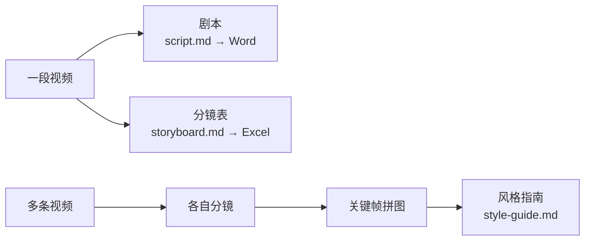
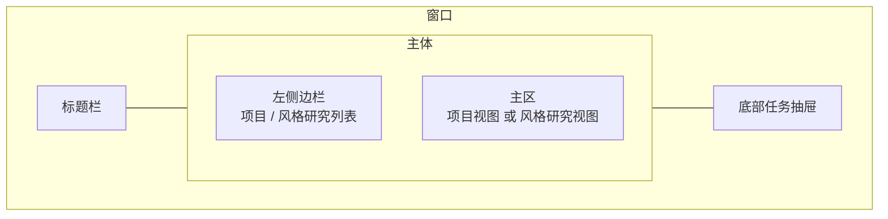

# 包拆拆（XLB Storyboard）用户手册

> 版本：1.0.4 · 适用平台：Windows / macOS
> 一句话定位：把视频「拆」成 **剧本** 和 **分镜表** 的桌面工具，并支持把多条爆款视频「蒸馏」成一份 **风格指南**。

---

## 目录

1. [软件简介与能做什么](#1-软件简介与能做什么)
2. [系统要求与安装](#2-系统要求与安装)
3. [首次配置（API Key / 供应商 / 代理）](#3-首次配置api-key--供应商--代理)
4. [界面总览](#4-界面总览)
5. [操作指南](#5-操作指南)
6. [配置项详解（config.yaml）](#6-配置项详解configyaml)
7. [数据与文件位置](#7-数据与文件位置)
8. [常见问题与故障排查（FAQ）](#8-常见问题与故障排查faq)
9. [小技巧与提示](#9-小技巧与提示)

---

## 1. 软件简介与能做什么

包拆拆是一款桌面应用，帮你把视频快速转成可阅读、可编辑、可导出的文字成果。它围绕两条业务线工作：

- **项目（单条视频）**
  - **生成剧本**：把一段视频转成带 `[HH:MM:SS]` 时间戳的文字剧本，可在线预览、按场景查看，并导出为 **Word（.docx）**。
  - **生成分镜表**：自动检测镜头切点、逐镜截图，再用 AI 识别每个镜头的「景别 / 角度 / 运镜 / 提示词描述 / 台词 / 音效」，可重新识别、手动补镜，并导出为 **Excel（.xlsx，含内嵌关键帧图片）**。
- **风格研究 / 蒸馏（多条视频）**
  - 同时对多条源视频跑分镜，抽取高分关键帧拼成网格图，再交给 AI 流式合成一份四段式 **《风格指南》**（Markdown）。

支持的 AI 供应商：

| 供应商 | 用途 | 说明 |
|---|---|---|
| **Gemini**（Google） | 剧本 / 分镜 / 合成 | 唯一支持长视频自动分段 + 合并的供应商 |
| **Kimi**（Moonshot） | 剧本 / 分镜 / 合成 | OpenAI 兼容接口 |
| **MiniMax-M3** | 剧本 / 分镜 / 合成 | OpenAI 兼容接口 |
| **自定义供应商** | 剧本 / 分镜 / 合成 | 任何 OpenAI 兼容的 `/chat/completions` 服务 |

> 提示：剧本和分镜可以分别选择不同的供应商。



---

## 2. 系统要求与安装

### 2.1 通用要求

- 操作系统：Windows 10/11（x64）或 macOS。
- 一个可用的 AI 供应商 **API Key**（见第 3 章）。
- 视频处理所需的 ffmpeg/ffprobe **已内置**在安装包中，无需另行安装。
- 联网环境（调用 AI 供应商需要访问其服务，部分供应商可能需要代理）。

### 2.2 Windows：安装版 vs 便携版

应用在 Windows 上提供两种发行形式：

| 形态 | 文件特征 | 数据保存位置 | 适合谁 |
|---|---|---|---|
| **安装版（NSIS）** | 安装程序，可自选安装目录 | `<安装目录>/data`（若不可写则回退到系统用户数据目录） | 长期使用、希望有开始菜单/桌面图标 |
| **便携版（Portable）** | 单个 exe，免安装、可放 U 盘 | `<exe 所在目录>/XLB Storyboard/data`（不可写则回退到系统用户数据目录） | 临时使用、不想安装、随身携带 |

> 安装版安装时**可更改安装目录**（非一键静默安装）。

⚠️ **重要：便携版数据位置的注意事项**

- 便携版会把项目数据写到 **exe 所在目录** 下的 `XLB Storyboard` 文件夹。请把便携版 exe 放到一个**固定、可写**的文件夹里（例如 `D:\包拆拆\XLB Storyboard.exe`）。
- **不要把便携版直接放在盘符根目录**（如 `D:\` 根、`C:\` 根）运行。请放进一个子文件夹再运行（详见 [FAQ：盘符根启动崩溃](#83-盘符根启动崩溃)）。
- 如果 exe 所在目录不可写（如只读介质、受保护目录），数据会**自动回退**到系统用户数据目录，换句话说，移动 exe 后可能「找不到」之前的项目（实为路径变了）。

### 2.3 macOS

- 提供 **dmg** 与 **zip** 两种包，均含 Apple Silicon（arm64）与 Intel（x64）。
- dmg：双击打开，将应用拖入「应用程序」文件夹即可。
- macOS 下数据保存在系统**用户数据目录**的 `data` 下（见第 7 章）。

---

## 3. 首次配置（API Key / 供应商 / 代理）

第一次使用前需要先填好至少一个供应商的密钥。

### 3.1 打开设置

点击标题栏 / 界面中的 **设置** 入口，打开「设置」弹窗。弹窗分三个标签页：

- **API 配置**：填写各供应商的 Key / base_url / model，并做连接测试。
- **功能配置**：选择剧本、分镜所用供应商，调阈值 / 最大分镜数 / 并发 / 提示词等。
- **关于**：版本信息。

### 3.2 逐供应商填写说明

> 填完每个供应商后，建议点其旁边的「连接测试」按钮验证是否可用（成功会返回可用模型列表）。

#### Gemini（Google）

| 字段 | 说明 | 默认 |
|---|---|---|
| API Key | Google AI 的密钥 | 空 |
| 模型（model） | 生成所用模型 | `gemini-3-flash-preview` |
| 视频清晰度（video_resolution） | `low`（推荐，省额度）/ `high`（更清晰更耗费） | `low` |
| 代理（proxy） | 留空时自动跟随系统代理；仍无则直连 | 空 |

- Gemini 通过官方 File API 上传视频，是**唯一支持长视频自动分段并合并**的供应商。
- 单段压缩目标约 200MB。

#### Kimi（Moonshot）

| 字段 | 说明 | 默认 |
|---|---|---|
| API Key | Moonshot 密钥 | 空 |
| 模型 | — | `kimi-k3` |
| base_url | 留空回退官方地址 | 留空回退 `https://api.moonshot.cn/v1` |

- 上传视频有体积约束：压缩目标 95MB，硬上限 100MB（超出会报错）。
- K3 会进行深度思考，应用会为完整剧本预留更大的输出空间，并在回答不完整时明确报错。
- Kimi 不做长视频分段，也不做时间戳缩放（长视频时间戳可能与画面略有偏差）。

#### MiniMax-M3

| 字段 | 说明 | 默认 |
|---|---|---|
| API Key | MiniMax 密钥 | 空 |
| 模型 | — | `MiniMax-M3` |
| base_url | 留空回退官方地址 | 留空回退 `https://api.minimaxi.com/v1` |

- 上传体积约束：压缩目标 95MB。
- 上传到云端的视频在 MiniMax 端约 7 天后自动过期。
- 会自动剥离模型「思考」内容，并对超出真实时长的时间戳做等比缩放校正。

#### 自定义供应商（OpenAI 兼容）

适用于任何 OpenAI 兼容的 `/chat/completions` 服务。需要填写：

- 名称（自定义显示名）
- API Key
- base_url（你的服务地址）
- model（模型名）

特点与约束：
- 视频以 **base64 内联**方式发送，内联上限约 **30MB**（比其他供应商小，超过会失败，请使用更短/更小的视频）。
- 同样会剥离思考内容并做时间戳缩放校正。

### 3.3 选择剧本 / 分镜所用供应商（功能配置）

在「功能配置」里：

- **剧本供应商（script_provider）**：可选 Gemini / Kimi / MiniMax / 你添加的自定义供应商。
- **分镜供应商（storyboard_provider）**：同上。
- 二者可不同。
- 若你删除了某个被选中的自定义供应商，相关选择会回退为 **Gemini**。

> 注意：默认配置中 Gemini 模型为 `gemini-3-flash-preview`；设置界面模型下拉里的「推荐」项可能是另一个版本。如果你不主动选择，实际调用的是配置里保存的那个模型。

### 3.4 代理设置

- 仅 Gemini 配置里有独立的「代理」字段。
- 优先级：**显式填写的代理 > 系统代理（自动探测）> 直连**。
- 仅支持 HTTP(S) 代理；不支持 SOCKS（遇到 SOCKS 会退回直连）。

---

## 4. 界面总览



- **标题栏**：窗口标题与控制按钮（Windows 下显示最小化 / 关闭）。
- **侧边栏**：上半部分是**项目列表**（每条对应一个视频），下半部分是**风格研究列表**。可新建、重命名、删除、打开所在目录。侧栏可折叠。
- **主区**：
  - 选中项目 → **项目视图**：左边视频播放器，右边「剧本 / 分镜」两个标签页。
  - 选中风格研究 → **风格研究视图**：左边源视频列表，右边风格指南（流式预览 / 完成态）。
  - 都未选中 → 欢迎页。
- **底部任务抽屉（Job Drawer）**：显示后台进行中 / 已完成的作业，分「剧本 / 分镜 / 研究」三个标签，可查看进度、流式产物、日志，并取消作业；已完成的可一键清空。

> 主区与任务抽屉之间是可上下拖拽的分栏，侧栏宽度也可拖拽调整。

---

## 5. 操作指南

每个任务按「目标 → 步骤 → 结果/产物 → 提示」组织。

### 5.1 新建项目并导入视频

- **目标**：把一段视频导入为一个项目。
- **步骤**：
  1. 侧边栏点「新建项目」。
  2. 选择本地视频文件。
- **产物**：项目列表出现一条新记录，主区进入项目视图，可立即播放视频。
- **提示**：
  - 在 macOS 应用商店（沙盒）版本下，源视频会被**拷贝**进项目目录（便于内部 ffmpeg 访问）；其他形态下直接引用原视频路径。
  - 因此在非沙盒版本里，**不要移动或删除原视频文件**，否则视频会无法显示。

### 5.2 生成剧本

- **目标**：把视频转成带时间戳的文字剧本。
- **步骤**：
  1. 在项目视图右侧切到「剧本」标签。
  2. 点「生成剧本」。
  3. 在底部任务抽屉的「剧本」标签观察进度。
- **过程中你会看到**：
  - 阶段化进度：准备 → 压缩 → 上传 → 等待处理 → 生成（→ 合并，仅 Gemini 长视频）。
  - **流式预览**：剧本文字边生成边显示。
  - Token 用量、已用时长、字数等（不同供应商上报能力不同，部分供应商 token 数可能不显示）。
- **取消**：在作业卡片点「取消」即可随时中止。
- **产物**：
  - 落盘 `script.md`（项目目录内）。
  - 剧本按场景切分，可在「剧本」标签按场景卡阅读（自动识别台词、动作 `△`、人物、字幕等）。
- **编辑**：剧本以场景卡形式展示；若某段没有可识别的时间戳，会降级为原文显示。
- **导出 Word**：点「导出 Word」，选择保存位置，得到 `剧本.docx`。
- **提示**：
  - 不同供应商的视频体积上限不同（Gemini 约 200MB、Kimi/MiniMax 约 95MB、自定义约 30MB）。视频太大请优先用 Gemini，或先压缩。
  - 长视频建议用 Gemini（自动分段 + 合并，时间戳更准）。

### 5.3 导入已有剧本

- **目标**：把已有的剧本文本作为一个项目导入（无需重新生成）。
- **步骤**：侧边栏选择「导入剧本」，选取剧本文件。
- **产物**：生成一个带剧本内容的项目，可直接查看 / 导出。

### 5.4 生成分镜表

- **目标**：把视频拆成一格格镜头，并由 AI 识别每镜的画面信息。
- **步骤**：
  1. 项目视图右侧切到「分镜」标签。
  2. （可选）先在「设置 → 功能配置」里调好灵敏度阈值、最大分镜数等。
  3. 点「生成分镜表」。
  4. 在底部任务抽屉「分镜」标签观察。
- **过程**：
  1. **检测切点**：用画面差异算法找镜头切换点。
  2. **截图核对**：逐镜截关键帧，作业面板里会显示截图采样网格 + 差异曲线，方便你核对切点是否合理。
  3. **占位铺表**：先铺出占位行（显示「识别中…」）。
  4. **AI 识别**：按并发分批识别每个镜头，逐镜实时填充。
- **产物**：
  - `storyboard.md`（分镜表）+ `frames/`（关键帧图片）+ `scene-scores.json`（差异曲线）。
  - 每镜含：镜号、时间范围、景别 / 角度 / 运镜、起止时间、关键帧图、提示词描述 / 台词 / 音效。
  - 提示词描述固定为七段：风格限定、景别、视角构图、主体描述、背景设定、细节修饰、光影色调，可直接复制用于视觉生成。
- **识别完成后的手动切割**：
  - 在播放器下方「帧差异值」曲线点击切点可查询并定位；空白处右键可新增，已有切点右键可精确调整或删除。
  - 首帧切点固定为 `00:00:00.000`，其余人工切点不受 0.4 秒间隔限制。
  - 移动切点后，未人工编辑的右镜会用新关键帧自动重识别；人工编辑过的内容会保留，除非显式点击「重新识别」。
  - 人工增删移动会持久化，重新切割或切换智能 / 场景切割方式后仍生效。
- **导出 Excel**：点「导出 Excel」，得到带内嵌关键帧图片的 `.xlsx`（含镜号 / 景别 / 角度 / 运镜 / 关键帧 / 时长 / 提示词描述 / 台词 / 音效列，首行冻结）。

#### 关键参数怎么调

| 参数 | 含义 | 调小会怎样 | 调大会怎样 | 默认 |
|---|---|---|---|---|
| **scene_threshold（灵敏度阈值）** | 判定「这是新镜头」所需的画面差异程度，范围 0.01~1 | 越小越敏感，**切点越多**、镜头更碎 | 越大越迟钝，**切点越少**、容易漏切 | 0.3 |
| **max_shots（最大分镜数）** | 一个视频最多保留多少镜头，范围约 10~500 | 超出后只保留首帧 + 差异最高的若干镜 | 允许更多镜头（更全但更慢、更耗额度） | 200 |
| **concurrency（识别并发）** | 同时识别几个镜头，1~10 | 更慢但更稳、更省并发额度 | 更快，但可能触发供应商限流 | 3 |
| **prompt（识别提示词）** | 给 AI 的图片识别指令 | 留空使用内置默认提示词 | 可自定义识别要求 | 内置默认 |

> 经验：镜头被切得太碎 → 调大阈值；该切的地方没切 → 调小阈值。改完阈值需要**重新生成分镜表**才生效。

#### 重新识别 / 手动调整切点

- **重新识别整表 / 仅失败镜**：在分镜标签右键菜单选择「全部重新生成」或「失败重新生成」。会**复用已有截图**重新识别，仅替换 AI 内容，保留镜号 / 起止时间。
- **重新识别单个镜头**：对单镜操作即可，只刷新该镜内容。
- **新增切点**：在差异曲线空白处右键 → 添加分镜。系统会在该时间截图，先插入「识别中」占位镜并按时间排序，再在后台异步补全识别结果；只要不是同一毫秒/同一帧即可新增，没有 0.4 秒限制。
- **移动 / 删除切点**：在已有切点上右键，可输入精确秒或 `HH:MM:SS.mmm` 调整，也可删除并合并前后镜；首帧锚点不可移动或删除。
- **提示**：分镜**正在首次生成**时，切点编辑会被禁用。等 AI 全部识别完成再操作。

### 5.5 编辑分镜与看懂场景差异曲线

- 分镜以卡片展示，每卡含缩略图与各字段。
- **场景差异曲线（SceneScoreCurve）**：横轴是时间，纵轴是相邻画面的差异分数。
  - 有一条**阈值线**：曲线峰值越过阈值线的地方，越可能被判为切点。
  - 标出了**切点**与**播放头**。
  - 可**点击曲线或切点 seek**到对应时间；空白处右键新增，切点右键移动或删除。
- 看懂它能帮你判断：阈值设得是否合适（峰太多说明阈值偏低，峰被埋说明阈值偏高）。

### 5.6 风格研究（多视频 → 风格指南）

- **目标**：把多条爆款视频「蒸馏」成一份可复用的风格指南。
- **步骤**：
  1. 侧边栏「风格研究」区点新建，**多选**若干源视频，给研究起个名字（默认取首个视频名）。
  2. 进入风格研究视图，点「开始研究 / 重新研究」。
  3. 在底部任务抽屉「研究」标签观察。
- **过程（两个阶段）**：
  1. **阶段 A**：按并发对每条视频各自跑分镜（检测切点 → 截图 → AI 识别），并按差异分数取高分关键帧拼成网格缩略图。
  2. **阶段 B**：把所有成功视频的分镜 + 拼图喂给 AI，**流式合成**一份四段式《风格指南》。
- **产物**：
  - `style-guide.md`（风格指南，可在界面复制或下载为 `.md`）。
  - 每条子视频各自的 `storyboard.md` / `frames/` / `thumbnail.jpg`（拼图）。
- **查看子分镜**：在源视频列表里点某条视频，可只读查看它的分镜表。
- **追加视频**：可随时「添加视频」。注意：**追加视频会让已生成的风格指南作废**（因为素材变了），需要重新研究。
- **提示**：
  - 单条视频识别失败不会中断整体，只要至少有一条成功就会继续合成（失败的会在指南末尾注明已跳过）。
  - 视频很多或分镜很长时，合成内容可能超出供应商上下文上限而失败——此时减少视频数量或降低单视频分镜数。
  - 「开始」按钮的密钥检查只看分镜供应商；若你把合成阶段指定成了未配密钥的自定义供应商，可能要到合成阶段才报错。

#### 风格研究相关参数

| 参数 | 含义 | 范围 / 默认 |
|---|---|---|
| video_concurrency | 同时研究几条视频 | 1~4，默认 2 |
| mosaic_frames_per_video | 每条视频取几张高分帧拼图 | 1~12，默认 6 |
| synthesis_provider | 合成所用供应商 | 默认继承分镜供应商 |
| synthesis_prompt | 合成提示词 | 留空用内置默认四段式提示词 |

### 5.7 项目 / 研究的重命名、删除、打开目录

- 在侧边栏对应条目上即可**重命名**、**删除**（删除会有确认）、**打开所在目录**（在系统文件管理器中定位）。
- 删除会移除该项目 / 研究的整个目录及其下所有文件，请谨慎。

---

## 6. 配置项详解（config.yaml）

所有设置最终保存到 `config.yaml`（YAML 格式）。下面是字段与默认值速查表。一般通过「设置」界面修改即可，无需手改文件。

```yaml
gemini:
  api_key: ''
  model: 'gemini-3-flash-preview'
  video_resolution: 'low'      # low | high
  proxy: ''                    # 留空跟随系统代理
kimi:
  api_key: ''
  model: 'kimi-k3'
  base_url: ''                 # 空回退 https://api.moonshot.cn/v1
minimax:
  api_key: ''
  model: 'MiniMax-M3'
  base_url: ''                 # 空回退 https://api.minimaxi.com/v1
custom_providers: []           # [{id,name,api_key,base_url,model}]
script_provider: 'gemini'      # 剧本供应商
storyboard_provider: 'gemini'  # 分镜供应商
storyboard:
  prompt: ''                   # 空用内置默认
  scene_threshold: 0.3         # 0.01~1
  max_shots: 200
  concurrency: 3               # 实际生效会被限制在 1~10
distillation:
  video_concurrency: 2         # 1~4
  synthesis_provider: null     # null=继承 storyboard_provider
  mosaic_frames_per_video: 6   # 1~12
  synthesis_prompt: ''         # 空用内置默认
```

字段说明：

| 字段 | 含义 | 默认 / 取值 |
|---|---|---|
| `gemini.video_resolution` | Gemini 视频清晰度 | `low`（省额度）/ `high` |
| `gemini.proxy` | Gemini 专用代理 | 空=跟随系统代理 |
| `*.base_url` | 各供应商接口地址 | 空时回退官方地址 |
| `script_provider` | 剧本用哪个供应商 | `gemini`/`kimi`/`minimax`/自定义 id |
| `storyboard_provider` | 分镜用哪个供应商 | 同上 |
| `storyboard.scene_threshold` | 切点灵敏度 | 0.3（越小越敏感） |
| `storyboard.max_shots` | 最大镜头数 | 200 |
| `storyboard.concurrency` | 识别并发 | 3 |
| `distillation.video_concurrency` | 研究时并发视频数 | 2（限 1~4） |
| `distillation.mosaic_frames_per_video` | 每视频拼图帧数 | 6（限 1~12） |
| `distillation.synthesis_provider` | 合成供应商 | null=继承分镜供应商 |

> ⚠️ 注意：应用启动时会把 `config.yaml` 读入内存并缓存。**运行期间手动改 `config.yaml` 不会被自动感知**，需要重启应用，或直接用「设置」界面修改（界面修改会即时生效并写盘）。
>
> ⚠️ `max_shots` 与 `concurrency` 若手动写入非法值（负数、0、非数字）可能导致行为异常，建议通过界面修改。

---

## 7. 数据与文件位置

### 7.1 数据根目录在哪

数据根目录（下文记为 `<dataRoot>`）按形态自动选择：

| 形态 | `<dataRoot>` |
|---|---|
| 开发模式 | `<应用目录>/data` |
| macOS（含商店版） | `<用户数据目录>/data` |
| Windows 便携版 | `<exe 所在目录>/XLB Storyboard/data` |
| Windows 安装版 | `<安装目录>/data` |
| 以上不可写时 | 一律回退到 `<用户数据目录>/data` |

`config.yaml` 位于 `<dataRoot>` 的**父目录**（例如便携版为 `<exe>/XLB Storyboard/config.yaml`）。

### 7.2 目录结构

```
<dataRoot>/
├─ projects/<项目id>/
│  ├─ project.json        # 项目元数据
│  ├─ script.md           # 剧本（生成后）
│  ├─ storyboard.md       # 分镜表（生成后）
│  ├─ scene-scores.json   # 帧差异曲线
│  └─ frames/             # 关键帧截图
├─ distillations/<研究id>/
│  ├─ project.json        # 研究元数据
│  ├─ style-guide.md      # 风格指南（合成后）
│  └─ videos/<序号_名称>/
│     ├─ storyboard.md
│     ├─ frames/
│     ├─ thumbnail.jpg    # 关键帧拼图
│     └─ sub.json
└─ logs/                  # 诊断日志
```

> 此外还存在一个 `<dataRoot>/storyboards/` 目录（历史遗留路径）；当前主流程的分镜数据都在 `projects/` 下，备份时以 `projects/` 与 `distillations/` 为准。

### 7.3 如何备份

- **备份**：复制整个 `<dataRoot>` 目录（含 `projects/`、`distillations/`），以及上层的 `config.yaml`。
- **迁移**：把这两者复制到新机器的对应位置即可。
- **便携版特别注意**：数据跟着 exe 所在目录走。要迁移便携版，请把整个 `XLB Storyboard` 文件夹连同 exe 一起复制。

---

## 8. 常见问题与故障排查（FAQ）

### 8.1 视频不显示 / 无法播放

- **原因 1**：原视频文件被移动 / 删除 / 重命名（非沙盒版本引用的是原始路径）。
  - 排查：确认原视频是否还在原位置。
- **原因 2**：视频编码浏览器内核不支持。
  - 排查：换一个常见编码（H.264/MP4）的文件试试。

### 8.2 关键帧 / 缩略图不显示

- 关键帧图片是从 `frames/` 目录读取的。
- 排查：确认项目目录下 `frames/` 内确有 `frame_*.jpg`；若整个项目目录被部分删除，重新「生成分镜表」即可重建。

### 8.3 盘符根启动崩溃

- **现象**：把便携版 exe 直接放在盘符根目录（如 `D:\`、`C:\`）运行时启动异常。
- **解决**：把便携版 exe 放进一个**子文件夹**再运行（如 `D:\包拆拆\XLB Storyboard.exe`），不要放在盘符根。

### 8.4 便携版「数据丢失」/ 找不到之前的项目

- 多数情况不是真丢，而是**数据路径变了**：
  - 便携版数据在 **exe 所在目录** 的 `XLB Storyboard/data`。移动了 exe，路径就变了。
  - 若 exe 目录不可写，数据会**回退到系统用户数据目录**。
- 排查：
  1. 回忆 exe 之前放在哪个文件夹，到那个文件夹的 `XLB Storyboard\data\projects` 看是否还在。
  2. 再到系统用户数据目录的 `data\projects` 看是否被回退保存到了那里。
  3. 找到后，把 exe 放回固定可写目录，或把数据复制到当前路径。

### 8.5 生成失败（剧本 / 分镜 / 研究）

按以下顺序排查：

1. **密钥 / 额度**：到「设置 → API 配置」点对应供应商的「连接测试」。失败说明 Key 错、额度用尽或接口地址不对。
2. **视频体积超限**：
   - 自定义供应商内联上限约 30MB；Kimi/MiniMax 约 95MB（硬上限 100MB）；Gemini 约 200MB。
   - 超限时换 Gemini 或先压缩 / 裁剪视频。
3. **网络 / 代理**：见 8.6。
4. **合成上下文超限（仅风格研究）**：视频太多或分镜太长导致超出模型上下文。减少视频数量或降低 `max_shots`。
5. **「模型在思考阶段被截断」**：MiniMax/自定义供应商返回的全是思考内容、没有正文。可换模型、缩短视频或重试。
6. 查看 `<dataRoot>/logs/` 下的诊断日志（错误信息里通常也会带日志文件路径）以定位细节。

### 8.6 网络与代理问题

- 仅 Gemini 有独立代理字段；其他供应商走系统网络。
- 优先级：显式代理 > 系统代理 > 直连。
- **不支持 SOCKS 代理**（会退回直连）。
- 排查：如果在需要代理才能访问的网络里用 Gemini，请在 Gemini 配置里填 HTTP(S) 代理，或确保系统代理已正确配置，再做连接测试。

### 8.7 密钥或额度错误

- 报错通常来自供应商接口。先用「连接测试」确认基本可用。
- 确认所选模型名拼写正确、base_url 正确、账户额度充足。

### 8.8 分镜切得太碎 / 漏切

- 太碎：调大 `scene_threshold`。
- 漏切：调小 `scene_threshold`，或手动在差异曲线上右键补镜。
- 改阈值后需**重新生成分镜表**。

### 8.9 进度条「卡」在末尾

- 生成阶段的进度是按文字量估算的启发式数值，长内容时会较早接近上限然后停在末端，这是**正常现象**，并非卡死。只要还在流式输出文字 / 还有日志更新，就说明在正常工作。

---

## 9. 小技巧与提示

- **省额度**：Gemini 的视频清晰度用 `low` 通常足够，识别更快更省。
- **长视频优先 Gemini**：只有 Gemini 会自动分段 + 合并，长视频的时间戳也更准。
- **先核对切点再等 AI**：分镜生成时先看「截图采样网格 + 差异曲线」，发现切点不合理可以取消，调整阈值后重来，避免白白消耗识别额度。
- **分别选供应商**：剧本和分镜可以用不同供应商，按各自表现和成本搭配。
- **风格研究先少后多**：先用 2~3 条视频跑通，确认风格指南满意，再追加更多视频（注意追加会让旧指南作废）。
- **善用任务抽屉**：所有作业都在底部抽屉里，可同时观察进度、流式产物与日志；完成后记得清空，保持界面整洁。
- **导出留存**：剧本导出 Word、分镜导出 Excel、风格指南可下载为 Markdown，便于分享与归档。
- **备份很简单**：定期复制 `<dataRoot>` 与 `config.yaml` 即可，无数据库依赖。

---

*本手册基于应用 1.0.4 版本编写。功能以实际版本为准。*
