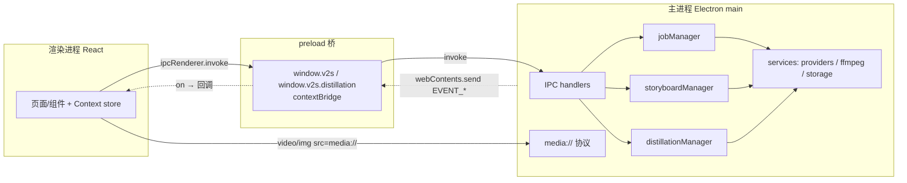
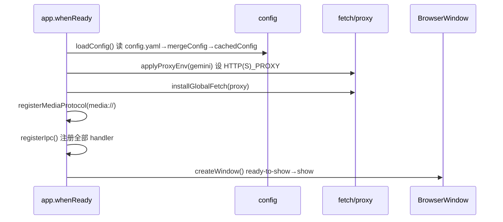
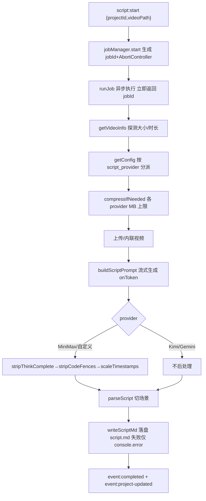
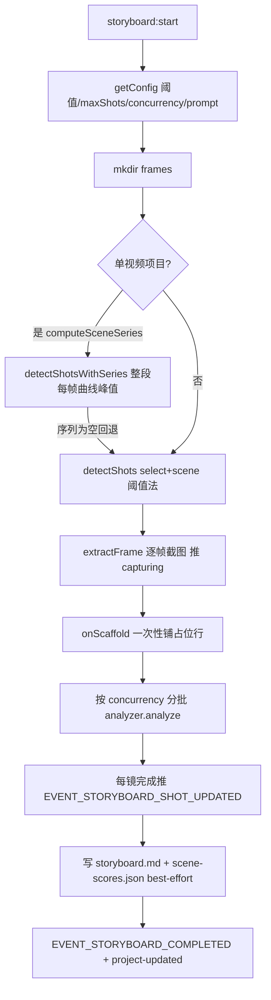
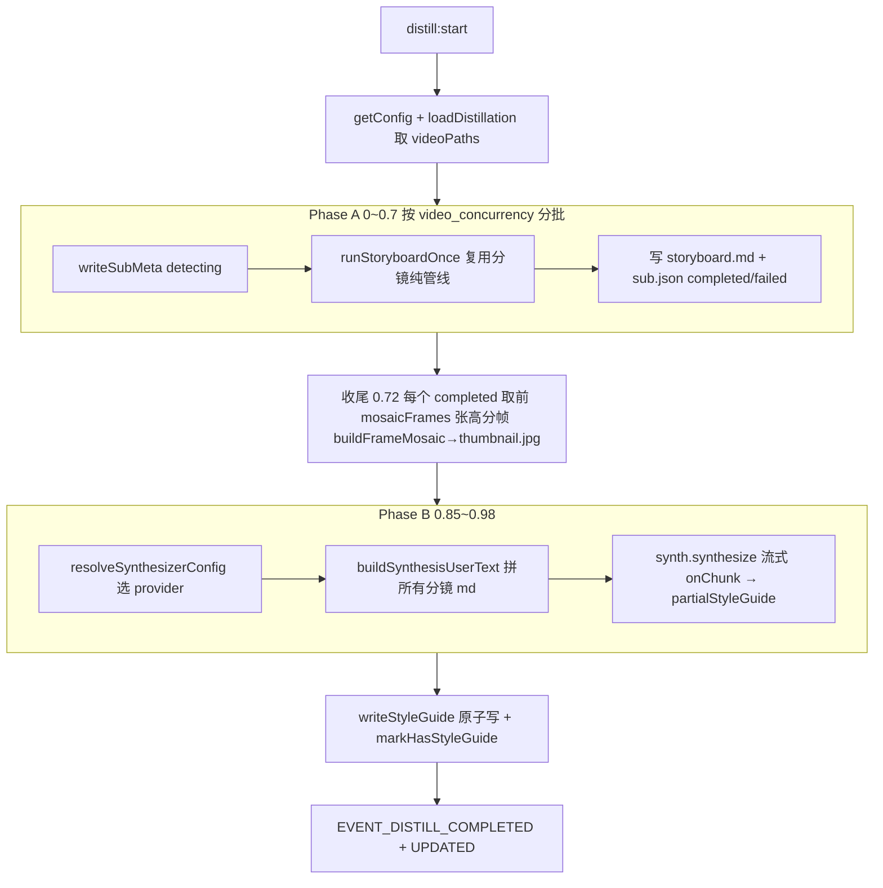

# 包拆拆（XLB Storyboard）设计文档

> 面向开发者的系统设计文档。本文以经源码核实的事实为唯一依据，描述包拆拆 / XLB Storyboard 桌面应用的架构、通信、数据模型、核心管线与渲染层设计。

---

## 1. 概述与产品定位

**包拆拆（XLB Storyboard）** 是一款把视频转换为「剧本」和「分镜表」的桌面工具，并支持「风格研究 / 蒸馏」——把多条爆款视频拆成分镜后合成一份《风格指南》。

| 字段 | 值 |
| --- | --- |
| package.json `name` | `v2script` |
| `version` | `1.0.4` |
| `appId` | `com.xlbstoryboard.app` |
| `productName` | `XLB Storyboard` |
| `description` | XLB Storyboard - 包拆拆 视频转剧本/分镜工具 |

### 三大核心能力

1. **剧本生成**：单个视频 → 带 `[HH:MM:SS]` 时间戳的文字剧本（场景化），可导出 DOCX。
2. **分镜表生成**：单个视频 → ffmpeg 切点检测 + 截帧 + AI 图像理解 → 结构化分镜表（景别/角度/运镜/七段式提示词描述/台词/音效），可导出 XLSX，支持增量加镜与重识别。
3. **风格研究 / 蒸馏**：多条源视频 → 各自跑分镜 → 高分关键帧拼图 → AI 流式合成四段式《风格指南》。

### 供应商无关

剧本与分镜两条链路均可在 **Gemini / Kimi(Moonshot) / MiniMax-M3 / 自定义 OpenAI 兼容供应商** 之间切换（分镜分析另支持 OpenAI 兼容图像理解）。供应商通过配置项 `script_provider` / `storyboard_provider` 选择。

---

## 2. 技术栈与依赖

### 运行时框架

| 层 | 技术 |
| --- | --- |
| 桌面外壳 | Electron 33（`electron-vite` 构建，三进程：main / preload / renderer） |
| 渲染层 | React 18 + TailwindCSS 3 + TypeScript 5 |
| 动画 | framer-motion 11 |
| 图标 | lucide-react |

### 关键依赖（dependencies）

| 包 | 用途 |
| --- | --- |
| `@google/genai` ^2.3.0 | Gemini 供应商：File API 上传、`generateContentStream` 流式生成、图像理解 |
| `undici` ^6.25.0 | 全局 `fetch` + `ProxyAgent`，`installGlobalFetch` 注入代理 |
| `ffmpeg-static` / `ffprobe-static` | 切点检测、截帧、压缩、分段、时长/分辨率探测 |
| `fluent-ffmpeg` | ffmpeg 调用封装（部分路径） |
| `js-yaml` | `config.yaml` 读写 |
| `docx` ^9.6.1 | 剧本导出 Word |
| `exceljs` ^4.4.0 | 分镜表导出 XLSX（内嵌关键帧图片） |
| `clsx` + `tailwind-merge` | 渲染层 `cn()` 类名合并 |

### 构建 / 打包

- `electron-vite`：三进程同构构建，构建期注入全局常量 `__APP_VERSION__`（取自 `package.json.version`）。
- `electron-builder`：Windows 出 `nsis` 安装版 + `portable` 便携版（x64）；macOS 出 `dmg` / `zip`（arm64+x64）及 `mas`（App Store）。

---

## 3. 总体架构

### 3.1 三进程职责与边界



| 进程 | 职责 | 关键文件 |
| --- | --- | --- |
| **main** | app 生命周期、窗口、全量 IPC handler、任务调度（三个 manager）、AI 供应商调用、ffmpeg、文件 IO、`media://` 协议、配置/路径 | `src/main/index.ts`、`src/main/job-manager.ts`、`src/main/services/*` |
| **preload** | 以 `contextBridge` 安全暴露 `window.v2s`（含 `.distillation`）；所有调用转 `ipcRenderer.invoke`，事件用 `ipcRenderer.on` 并返回取消订阅闭包；本地计算 `media://` URL | `src/preload/index.ts` |
| **renderer** | 两条业务线 UI、React Context + useReducer 状态、订阅推送事件、流式产物展示、配置编辑 | `src/renderer/src/**` |
| **shared** | 三方共用类型、IPC 通道常量、默认值、`parseScript` 纯函数 | `src/shared/*` |

### 3.2 窗口与安全边界

主窗口（`src/main/index.ts`）：

- 尺寸 1440×900，`titleBarStyle: 'hiddenInset'`（自定义标题栏）。
- `webPreferences`：`contextIsolation: true`、`nodeIntegration: false`、`sandbox: false`、挂载 `preload`。
- dev 加载 `ELECTRON_RENDERER_URL`，否则加载打包后的 `index.html`。
- `ready-to-show` 后才 `show`，避免白屏闪烁。

### 3.3 启动序列



启动鲁棒性：配置/代理初始化包裹在 `try/catch` 中，失败也不阻塞建窗；`whenReady().catch` 用 `dialog.showErrorBox` 兜底；进程级 `uncaughtException` / `unhandledRejection` 仅记日志不退出。

---

## 4. 进程间通信设计（IPC）

所有通道名集中定义在 `src/shared/ipc-channels.ts` 的 `IPC` 常量对象，main 与 renderer 共享，避免硬编码漂移。调用走 `ipcRenderer.invoke`（返回 Promise），推送走 `webContents.send`（renderer 用 `on` 订阅并返回取消函数）。

### 4.1 invoke 通道目录（renderer → main）

#### 配置类

| 通道 | 入参 | 返回 |
| --- | --- | --- |
| `config:get` | — | `AppConfig` |
| `config:set` | `AppConfig` | `{ok:true}`（保存 + `installGlobalFetch`） |
| `config:test-connection` | `override?` | `ConnectionTestResult` |
| `config:test-storyboard-connection` | `override?` | 按 `storyboard_provider` 分派 |
| `config:test-kimi` | `KimiConfig` | `ConnectionTestResult` |
| `config:test-minimax` | `MinimaxConfig` | `ConnectionTestResult` |
| `config:test-custom-provider` | `CustomProvider` | `ConnectionTestResult` |

#### 文件 / 窗口类

| 通道 | 说明 |
| --- | --- |
| `file:pick-video` / `file:pick-videos` / `file:pick-script` | 选路径或 `null` |
| `file:save-script` | `{defaultName,content}` 写 UTF-8 |
| `file:read-script` | 读文本 |
| `file:save-storyboard` | 校验源存在 → `copyFile` → 清理临时目录 |
| `file:open-in-folder` | `shell.showItemInFolder` |
| `file:get-video-url` | `buildMediaUrl` → `media://local/<base64url>` |
| `shell:open-external` / `window:close` / `window:minimize` | 外链 / 窗口控制 |

#### 视频 / 剧本 / 分镜 / 项目 / 风格研究

| 分组 | 通道 |
| --- | --- |
| 视频/剧本 | `video:get-info`、`script:start`→`{jobId}`、`script:cancel`→`{ok}` |
| 分镜 | `storyboard:start`→`{jobId}`、`storyboard:cancel`、`storyboard:reanalyze`→`{ok,updated,failed}`、`storyboard:add-shot`→`{ok,index,reason?}`、`storyboard:pick-project`、`storyboard:load-project` |
| 项目 | `project:list/create/rename/delete/load/load-script/load-storyboard/load-scene-scores/import-script/import-storyboard/open-dir/export-script-docx/export-storyboard-xlsx` |
| 风格研究 | `distill:list/create/load/rename/delete/load-style-guide/load-sub-storyboard/open-dir/start/cancel/add-videos` |

> **调用约定注意**：绝大多数 invoke 传单一对象参数；`distill:add-videos` 例外，传两个位置参数 `(id, videoPaths)`，主进程 handler 需按 `(event,id,videoPaths)` 取参（见 §11）。

### 4.2 main → renderer 推送事件清单

| 事件常量 | 通道字符串 | 载荷 | 消费方 |
| --- | --- | --- | --- |
| `EVENT_PROGRESS` | `event:progress` | `ProgressEvent` | 剧本作业进度 |
| `EVENT_COMPLETED` | `event:completed` | `ScriptResult` | 剧本完成 |
| `EVENT_FAILED` | `event:failed` | `{jobId,message}` | 剧本失败 |
| `EVENT_PROJECT_UPDATED` | `event:project-updated` | `{id}` | 触发重载项目 |
| `EVENT_STORYBOARD_PROGRESS` | `event:storyboard-progress` | `StoryboardProgressEvent` | 分镜进度 |
| `EVENT_STORYBOARD_SCAFFOLD` | `event:storyboard-scaffold` | `{jobId,projectId,shots,framePaths}` | 一次性铺占位行 |
| `EVENT_STORYBOARD_SHOT_UPDATED` | `event:storyboard-shot-updated` | `{projectId,index,shot,error?}` | 逐镜增量填充 |
| `EVENT_STORYBOARD_COMPLETED` | `event:storyboard-completed` | `{jobId,videoPath,xlsxPath:'',shots}` | 分镜完成 |
| `EVENT_STORYBOARD_FAILED` | `event:storyboard-failed` | `{jobId,message}` | 分镜失败 |
| `EVENT_DISTILL_PROGRESS` | `event:distill-progress` | `DistillationProgressEvent` | 研究进度 |
| `EVENT_DISTILL_COMPLETED` | `event:distill-completed` | `{jobId,meta,styleGuide}` | 研究完成 |
| `EVENT_DISTILL_FAILED` | `event:distill-failed` | `{jobId,message}` | 研究失败/取消（取消 `message='已取消'`） |
| `EVENT_DISTILL_UPDATED` | `event:distill-updated` | `{id}` | 随完成一并发，触发重载 |
| `EVENT_LOG` | `event:log` | — | **常量已定义但 preload 未暴露订阅**（当前渲染层不可消费） |

> 发送前主进程统一用 `sender.isDestroyed()` 判活，避免窗口关闭瞬间 `send` 抛错。

---

## 5. 数据模型

核心类型定义于 `src/shared/types.ts`，是三方单一事实源。

### 5.1 配置（`AppConfig` ↔ `config.yaml`）

```yaml
gemini:
  api_key: ''
  model: 'gemini-3-flash-preview'
  video_resolution: 'low'   # low | high
  proxy: ''
kimi:
  api_key: ''
  model: 'kimi-k3'
  base_url: ''              # 默认回退 https://api.moonshot.cn/v1
minimax:
  api_key: ''
  model: 'MiniMax-M3'
  base_url: ''              # 默认回退 https://api.minimaxi.com/v1
custom_providers: []         # CustomProvider{id,name,api_key,base_url,model}
script_provider: 'gemini'
storyboard_provider: 'gemini'
storyboard:
  prompt: ''                # 空则用 STORYBOARD_DEFAULT_PROMPT
  scene_threshold: 0.3      # 合并时钳制 0.01..1
  max_shots: 200
  concurrency: 3            # 运行时 clamp 1..10
distillation:
  video_concurrency: 2      # 钳制 1..4
  synthesis_provider: null  # null = 继承 storyboard_provider
  mosaic_frames_per_video: 6  # 钳制 1..12
  synthesis_prompt: ''      # 空则用 DISTILLATION_DEFAULT_PROMPT
```

序列化：`js-yaml`，`indent: 2`、`lineWidth: 120`。读取经 `mergeConfig` 做默认回退与范围钳制；`getConfig()` 在未 `loadConfig` 时抛 `Config not loaded yet`。`cachedConfig` 单例：一旦加载便不再读盘，外部手动改 `config.yaml` 需重启才生效。

### 5.2 作业与进度类型

```ts
// 剧本作业状态联合
type JobStatus =
  | 'pending' | 'preparing' | 'compressing' | 'uploading'
  | 'waiting_process' | 'generating' | 'merging'
  | 'completed' | 'failed' | 'cancelled'

interface ProgressEvent {
  jobId: string; status: JobStatus; progress: number /*0-1*/; message: string
  partialScript?: string; currentSegment?: number; totalSegments?: number
  elapsedMs?: number; etaMs?: number; tokensUsed?: number; videoSizeBytes?: number
}

interface ScriptResult {
  jobId: string; videoPath: string; durationSec: number
  script: string; scenes: ScriptScene[]
  generatedInMs: number; generatedAt: number; scriptPath?: string
}
interface ScriptScene { charStart; charEnd; startSec; heading; body; number }
```

### 5.3 分镜类型

```ts
interface StoryboardShot {
  number: number; shotType: string; angle: string; cameraMove: string
  description: string /* 固定七行提示词描述 */; dialogue: string; sound: string
  timeRange: string; startSec: number; endSec: number; sceneScore: number /*0-1，首帧0*/
  userEdited?: boolean
}
interface StoryboardProject { id; videoPath; createdAt; shots: StoryboardShot[]; framePaths: string[] }

interface SceneScoreData { threshold; durationSec; points: { t; score }[] }
```

`StoryboardProgressEvent.status`：`detecting | capturing | analyzing | generating | completed | failed | cancelled`，并可带 `threshold / capturedFrame / sceneSeries / kind('generate'|'reanalyze') / projectId / providerLabel`。

解析兜底：`shotType` 归一到六档，`angle='平视角'`、`cameraMove='静态镜头'`；非结构化返回会放入「主体描述」，再补成固定七行。

### 5.4 蒸馏类型

```ts
interface DistillationMeta { id; name /*默认'未命名研究'*/; videoPaths: string[]; createdAt; updatedAt; hasStyleGuide: boolean }
interface DistillationSubVideo {
  videoPath; videoName; status; progress; message; shots
  errorMessage?; storyboardPath?; thumbnailPath?
}
// status: pending|detecting|analyzing|completed|failed (加载时 detecting/analyzing 复位为 pending)
// Job.status: preparing|analyzing_subs|building_mosaics|synthesizing|completed|failed|cancelled
```

### 5.5 持久化文件格式

| 文件 | 格式 | 关键字段 |
| --- | --- | --- |
| `project.json` | JSON 2 空格缩进，原子写（`.tmp`→rename） | `{id,name,videoPath,createdAt(ms),updatedAt(ms)}` |
| `script.md` | UTF-8 纯文本剧本 | 带 `[HH:MM:SS]` 时间戳的场景文本 |
| `storyboard.md` | Markdown | `源视频`(basename)、`生成时间`、`总镜头数`；每镜 `## 镜 N | timeRange` + **景别/角度/运镜**、**开始时间**(HH:MM:SS)、**起始秒**(toFixed3)、**结束秒**(toFixed3)、**场景差异**(toFixed4，仅 score>0)、``、**提示词描述（fenced text 多行块）/台词/音效**；旧 `**描述**` 单行继续兼容读取 |
| `storyboard-boundary-overrides.json` | JSON，临时文件 + rename 原子写 | 人工切点覆盖层：`version / forced(ms)[] / suppressed(ms)[] / updatedAt` |
| `scene-scores.json` | 紧凑 JSON（无缩进） | `SceneScoreData`；`readSceneScores` 校验 `points` 必须为数组 |
| `frames/frame_*.jpg` | JPG | 文件名 `frame_<round(timestamp*1000) 左补0至8位>.jpg`，避免三位小数的浮点下溢造成重名 |
| `style-guide.md` | Markdown（原子写） | 四段式风格指南；`failed>0` 时尾部追加跳过说明 |
| `sub.json` | JSON | `DistillationSubVideo` 状态真实来源 |

---

## 6. 存储与路径设计

### 6.1 数据根目录解析（`src/main/services/paths.ts`）

`getDataRoot()` 带 `cachedDataRoot` 缓存，按形态做可写性探测回退：

| 形态 | 数据根 `getDataRoot()` |
| --- | --- |
| 开发 | `<appPath>/data` |
| macOS 打包（含 MAS） | `<userData>/data` |
| Windows portable | `<PORTABLE_EXECUTABLE_DIR>/XLB Storyboard/data` |
| Windows 安装/解压 | `<安装目录>/data` |
| 回退（盘符根/不可写） | `<userData>/data` |

`config.yaml` 位于 `dirname(getDataRoot())`，即数据根的父目录（如 `<exe>/XLB Storyboard/config.yaml` 或 `<userData>/config.yaml`）。

`isWritableDir` 用写探测文件 `.v2s-write-test`（`writeFileSync('')` 后 `unlinkSync`）判断；极端情况下删除失败会残留探测文件（静默忽略）。

常量：`APP_DATA_DIRNAME = 'XLB Storyboard'`；`isSandboxed()` 基于 `process.mas` 判定 MAS 沙盒。

### 6.2 目录布局

```
<dataRoot>/
├── projects/<uuid>/
│   ├── project.json
│   ├── script.md            (可选)
│   ├── storyboard.md        (可选)
│   ├── scene-scores.json    (可选)
│   └── frames/frame_*.jpg
├── storyboards/<id>/        ← storyboard-storage 的遗留 CRUD 路径（与 projects/ 并存，见 §11）
├── distillations/<id>/
│   ├── project.json
│   ├── style-guide.md
│   └── videos/<subIndex>_<safeBaseName>/
│       ├── storyboard.md  ├── frames/  ├── thumbnail.jpg  └── sub.json
└── logs/<scope>-<id>.log
```

`safeBaseName`：去扩展名后把 `\/:*?"<>|` 替换为 `_` 并截断 80 字符，空则 `'video'`，前缀为 1-based subIndex。

临时导出：`app.getPath('temp')/storyboard-<projectId>.xlsx`，导出后删除。

### 6.3 `media://` 协议

URL 格式：`media://local/<base64url-of-absolute-path>`。用 base64url 编码避免 Windows 路径 `:\/` 破坏 URL 解析。

主进程 `protocol.handle('media', ...)`：

- 解码 base64url → 绝对路径 → `stat`。
- **小于 5MB**（多为图片）用 `fs.readFile` 整文件返回 200，规避 `Readable.toWeb` 流兼容问题。
- **否则**（视频）`createReadStream` + `Readable.toWeb`，支持 HTTP Range（`<video>` seek 必需），返回 200/206，非法 Range 返回 416，并对 start/end 做防御性裁剪。

preload 侧 `getMediaUrl(absPath)` 用 `Buffer.base64url` 同步本地计算（不经 IPC）；另有异步的 `getVideoMediaUrl` 走 IPC。两条获取 URL 的路径并存。

### 6.4 asar / ffmpeg 路径

`asarUnpack` 配置 `ffmpeg-static` / `ffprobe-static` 解包到 `app.asar.unpacked`。运行时各调用点把二进制路径中的 `app.asar` 字符串替换为 `app.asar.unpacked`（`FFMPEG_BIN` / `FFPROBE_BIN`）。

---

## 7. 核心模块设计

### 7.1 配置与多供应商抽象

`src/main/services/config.ts` 负责加载/保存/合并：`DEFAULT_CONFIG`、`mergeConfig`（范围钳制）、`applyProxyEnv`（写 `HTTP(S)_PROXY`）、`cachedConfig` 单例。

供应商分派：剧本看 `script_provider`，分镜看 `storyboard_provider`，可取 `gemini` / `kimi` / `minimax` / 某个 `custom_providers[].id`。**未匹配时静默回退 Gemini**（包括 provider 指向已删除的 custom id 的情况）。

| 供应商 | 视频投递 | 默认 model | base_url 默认 | 体积约束 | 流式特性 |
| --- | --- | --- | --- | --- | --- |
| Gemini | File API 上传 | `gemini-3-flash-preview` | — | 单段压缩目标 200MB（硬编码） | 唯一支持长视频分段+合并 |
| Kimi(Moonshot) | `POST /v1/files`(purpose=video)，`ms://{id}` | `kimi-k3` | `api.moonshot.cn/v1` | 压缩 95MB，硬上限 100MB | SSE 流，K3 深度思考 + Partial Mode，不设应用级输出上限，完整性校验 |
| MiniMax-M3 | `/v1/files/upload`(video_understanding)，`mm_file://{id}` | `MiniMax-M3` | `api.minimaxi.com/v1` | 压缩 95MB | 剥 `<think>` + 时间戳缩放，不设应用级输出上限 |
| 自定义 OpenAI 兼容 | base64 内联 `data:` URL | 用户配置 | 用户配置 | 内联 30MB | 同 MiniMax 后处理，不设应用级输出上限 |

代理优先级：显式 `proxy` > `session.resolveProxy` 系统代理（PAC/WPAD/IE）> 直连（SOCKS 不支持则直连）。`installGlobalFetch` 用 undici 替换 `globalThis.fetch`；**不用 Electron `net.fetch`**（流式上传 `ERR_INVALID_ARGUMENT`），**不用 Node 内置 fetch**（与 npm undici 不同实例致代理失效）。

### 7.2 剧本生成管线



- **进度映射**（`job-manager`）：`preparing 0.05 / compressing 0.1 / uploading 0.18 / waiting_process 0.32 / generating 0.42 / merging 0.92`；生成阶段按 `acc.length/4000` 估算，`Math.min(0.95)` 封顶。
- **Gemini 长视频**：`segmentVideo` 切段 → 逐段 `generateSingle`（每段重置展示）→ `mergeSegments` 合并。Kimi/MiniMax/自定义均单次整段。
- **后处理差异**：MiniMax/自定义剥 `<think>` 并对「最大时间戳 > durationSec+1」的剧本做以 0 为锚的等比时间戳缩放；Gemini/Kimi 不缩放（Kimi 既不分段也不缩放，长视频可能时间漂移）。
- **空内容防御**：各 provider 流结束时 `acc` 为空抛错；MiniMax/自定义剥思考后为空抛「模型在思考阶段被截断」。
- **SSE 解析**：按 `\r\n\r\n|\n\n` 切事件（兼容 CRLF/LF），buffer 保留不完整尾段防 TCP 分包丢 token，`[DONE]` 结束。
- **上传伪进度**：无原生进度，用 800ms 定时器、假设 2MB/s、封顶 0.99。
- **清理**：`finally` 删除已上传云端文件与压缩临时文件（均吞错；MiniMax 端 7 天自动过期）。
- **导出 DOCX**：`readScriptMd → parseScript → generateScriptDocx`（`docx` 库），`dialog` 保存（默认名 `剧本.docx`）。

### 7.3 分镜表管线



| 阶段 | 进度区间 |
| --- | --- |
| detecting | 0.05–0.15 |
| capturing | 0.15–0.45 |
| analyzing | 0.45–0.90 |
| saving/generating | 0.92 |
| completed | 1 |

- **切点检测**：`detectShots` 用 ffmpeg `select+scene` 差异阈值；`detectShotsWithSeries` 整段采集每帧差异曲线取峰值。后处理 `postProcessShots`：补 `timestamp=0` 首帧、`toFixed(2)` 去重、超 `maxShots` 时保留首帧 + 按 score 取前 `maxShots-1` 再按时间排序；检测 <2 个切点时均匀补帧（上限 `min(maxShots,60)`）。
- **截帧**：`extractFrame` 用 ffmpeg `-ss + scale=854:-2 + -q:v 2` 输出 jpg。
- **AI 识别**：`createAnalyzer(cfg)` 支持 Gemini（`@google/genai`，低思考）与 OpenAI 兼容（`/chat/completions`，不发 temperature），正式请求均不设应用级输出上限；Claude 因 API 字段必填而使用模型最大输出值。上游返回截断、拒绝或空内容时明确报错；结构解析失败时再用正则提取 `{…}` 后 `JSON.parse`，仍失败则使用默认字段。
- **脚手架**：先一次性下发占位行（`shotType='识别中…'`）再逐镜增量填充，失败保留旧镜并带 `error`。
- **增量能力**：
  - `reanalyze(projectId,indices)`：复用截图重识别选定镜头，仅替换 AI 内容，保留 `number/startSec/endSec/timeRange/sceneScore`；`updated>0` 才写盘，取消也落已完成部分。
  - `addShot(projectId,timeSec)`：仅拒绝同毫秒、首帧或视频范围外切点，不再使用 0.4 秒限制；先落「识别中」占位镜，再后台按新关键帧补全。
  - `moveShot(projectId,index,timeSec)`：移动的是右镜起点；左镜只延伸/缩短区间，右镜重截关键帧。`userEdited=true` 时保留内容，否则自动重识别。
  - `deleteShot(projectId,index)`：删除右镜及其关键帧，左镜吞并区间；首帧不可移动或删除。
  - 人工边界持久化到 `storyboard-boundary-overrides.json`：`forced` 强制加入，`suppressed` 阻止被删/移走的自动点复活；重新切割与切换方式时合并到自动结果。
  - 同一 `projectId` 的 reanalyze/addShot/moveShot/deleteShot/recognize 共用 `reanalyzeChains` 串行链，避免写盘互覆盖。
- **曲线持久化**：`scene-scores.json`（best-effort，失败仅记日志）。`SCENE_SERIES_MAX_POINTS=1500` 降采样上限。
- **导出 XLSX**：`generateStoryboardXlsx`（`exceljs`），列 `镜号/景别/角度/运镜/关键帧/时长/提示词描述/台词/音效`，行高 180，关键帧列内嵌图片，首行冻结；写临时文件再 `copyFile` 到目标后删临时。完成事件 `xlsxPath` 恒为 `''`，XLSX 仅在显式导出时按需生成。
- **长视频参数**（`video.ts`）：`SEGMENT_THRESHOLD_SEC=2h`、`SEGMENT_DURATION_SEC=30min`、`SEGMENT_OVERLAP_SEC=30s`；压缩 `maxMB=50→scale=854:-2,fps=2,crf32,veryfast`。

### 7.4 风格研究 / 蒸馏管线

两阶段：



- **并发模型**：Phase A 按 `video_concurrency` 分批 `Promise.all`，批间串行（队头阻塞，非滑动 worker 池）。
- **容错**：单子视频失败仅 `failed++` 跳过，仅 `successCount==0` 才整体失败；单个拼图失败不影响合成（无图则纯文本）。
- **进度**：整体 = `0.7 × (ΣsubProgress/totalSubs)`，失败 sub 计 0 拉低分母；合成段 `0.85 + 0.13×min(1, acc.length/4000)`。
- **拼图**（`distillation-mosaic.ts`）：ffmpeg `xstack` 4 列网格，单元格 480×270 硬编码，绝对像素坐标 `col*480_row*270`；单帧（N==1）走 `scale+pad` 单路分支。
- **合成 prompt**：`synthesis_prompt` 为空用 `DISTILLATION_DEFAULT_PROMPT`（固定四个一级标题结构）。
- **后处理缺口（现状）**：合成器（`synthesizer.ts`）当前**不剥离 `<think>` 思考块**，与剧本链路（`stripThinkComplete`）、分镜链路（`stripThink`）不对称。当 `synthesis_provider` 选 MiniMax-M3 或内联 `<think>` 的自定义供应商时，思考内容会被原样写入 `style-guide.md`（详见《审查报告》H-1，已列入 P0）。
- **重启恢复**：`loadDistillation` 把 `detecting/analyzing` 复位为 `pending`，避免 UI 卡转圈；`start` 不读既有 sub 状态，总是从 pending 重研究覆盖。
- **追加视频**：`addVideosToDistillation` 先 `importMediaToContainer` 拷入容器再去重；新增视频会令旧 `hasStyleGuide` 置 false（指南作废）。

### 7.5 项目管理与导入导出

`project-storage.ts`（每项目一目录）+ `media-import.ts`（沙盒拷贝），不注册 IPC，是 service 层。

- **CRUD**：`createProject / listProjects / loadProject / renameProject / deleteProject / touchProject`。`listProjects` 仅扫目录项、按 `updatedAt` 倒序，单个损坏项目静默跳过。
- **原子写与串行**：`project.json` 经 `writeMeta`（`.tmp`→rename）原子写；`withMetaLock` 用 `Map<id,Promise>` 链式串行 read-modify-write，防止异步分镜识别频繁 `touchProject` 与用户 `renameProject` 交错丢更新。
- **媒体导入**：仅沙盒（`process.mas`）下把源视频拷入项目容器目录；`copyIntoContainerUnique` 用 `COPYFILE_EXCL`，`EEXIST` 时按体积比对去重或追加 `_1.._1000` 序号。非沙盒原样返回外部路径。
- **导入为项目**：`importScriptAsProject` / `importStoryboardAsProject`。

### 7.6 任务作业与进度事件

三个单例 manager（`jobManager` / `storyboardManager` / `distillationManager`）统一模式：

| 能力 | 实现 |
| --- | --- |
| 标识 | `randomUUID()` 生成 `jobId`，登记到 `active: Map<id, {controller}>` |
| 取消 | 每作业一个 `AbortController`，`cancel(jobId)` 调 `abort()`；`signal` 透传 ffmpeg(kill 子进程) 与 AI 请求 |
| 区分取消/失败 | catch 中判 `signal.aborted` → `cancelled`，否则 `failed` |
| 窗口关闭 | `closed` 时三个 manager 一并 `cancelAll()`（后台作业无条件中断） |
| 无重试 | manager 本身不重试，失败即推 failed（重试若有则在 provider service 内） |

`runStoryboardOnce` 为无状态纯管线，被 `storyboardManager` 与 `distillationManager` 共享复用。

---

## 8. 渲染层设计

### 8.1 布局系统

入口 `main.tsx → App(AppShell)`：`BootScreen → PreloadGuard → StoreProvider → TitleBar/Sidebar/MainArea/SettingsModal`。`MainArea` 按选中状态在 `DistillationView / ProjectView / 欢迎页` 切换，并用 `ResizableSplit` 垂直分出底部 `JobDrawer`。

```
AppShell (scanlines flex h-full flex-col)
├── TitleBar
└── 主体 (flex flex-1 overflow-hidden)
    ├── Sidebar (clamp 150~400，折叠 48)
    ├── resize handle
    └── MainArea
        └── ResizableSplit vertical
            ├── ProjectView (grid h-full grid-rows-[auto_1fr])
            │   ├── 顶部栏 (shrink-0)
            │   └── ResizableSplit horizontal
            │       ├── 视频+控制 (grid grid-rows-[1fr_auto])
            │       └── 剧本/分镜 tab
            └── JobDrawer
```

### 8.2 状态管理 store

`lib/store.tsx`：`AppState + reducer + StoreProvider`。初始化时并行拉 `getConfig / listProjects / distillation.listDistillations + 逐个 loadDistillation`，并注册全部 IPC 事件监听（返回 cleanup `off()`）。导出 `useStore / useSelectedProject / useSelectedDistillation`。

| 状态片 | 要点 |
| --- | --- |
| `CurrentJob` | 剧本作业；`log` 保留 30 条 |
| `StoryboardJob` | `kind('generate'\|'reanalyze')`、`capturedFrames`、`sceneSeries`；`log` 50 条 |
| 选择互斥 | `SELECT_PROJECT` 清 distillation，`SELECT_DISTILLATION`/`DISTILLATION_CREATED` 清 project |
| reanalyze 建卡 | 无 `JOB_START`，靠首个带 `projectId` 的进度事件即时建任务卡 |
| 合并保留 | `DISTILLATIONS_LOADED` 合并时保留运行中子视频内存态与已加载 styleGuide |

所有副作用经 `api() = window.v2s`（`lib/api.ts`）调主进程。

### 8.3 页面与关键组件

| 组件 | 职责 |
| --- | --- |
| `ProjectView` | 左视频播放器 + 右剧本/分镜 tab；启动生成、导出、时间轴场景点、识别完成后的曲线切点 CRUD |
| `DistillationView` | 左源视频列表 + 右风格指南（流式/完成态）；开始/重研究、复制/下载 md、追加视频 |
| `CreateDistillationDialog` | 新建风格研究弹窗：多选源视频 + 命名（首个视频 basename 自动建议名），创建研究项目 |
| `AddDistillationVideosDialog` | 向已有研究追加源视频的弹窗（去重后回调 `onAdded`，触发指南作废重研究） |
| `SubStoryboardModal` | **只读**查看某条子视频已生成的分镜（复用 `StoryboardEditorTab` 渲染，经 `loadDistillationSubStoryboard` 加载）——风格研究的「查看子分镜」入口 |
| `ScriptEditorTab` | 剧本场景卡：按 `\n` 拆台词/动作(△)/人物/字幕，剥时间戳前缀；无时间戳降级原文 `pre` |
| `StoryboardEditorTab` | 分镜卡 + 缩略图、右键全部/失败重识别、单镜重识别、监听 shot-updated 增量更新 |
| `SettingsModal` | API 配置（四类供应商）+ 功能配置（provider/阈值/最大分镜/并发/prompt）+ 关于 |
| `JobDrawer` / `*JobPanel` | 底部任务抽屉三 tab；各面板 Hero/Timeline/Log/流式产物/取消 |
| `SceneScoreCurve` | 帧差异曲线 SVG：阈值线/折线/填充/播放头/切点；点击查询/seek，空白右键新增，切点右键精确移动或删除 |
| `BootScreen` | 开机动画，rAF/CSS，约 4.65s 后 `onComplete` |
| `PreloadGuard` | 轮询 `window.v2s`（100ms/超时 5s），未就绪显示错误页 |

### 8.4 已沉淀的 UI 技术决策

| 决策 | 原因 |
| --- | --- |
| `ProjectView` 外层用 **grid 而非 flex** | 嵌套 flex 中 `flex-1 = flex:1 1 0%`，子元素 `height:100%` 可能基于 `flex-basis:0%` 算成 0，导致历史项目加载后视频区高度被压为 0。改 `grid grid-rows-[auto_1fr]` 让第二行天然获得明确剩余高度。 |
| `media://local/<base64url>` | base64url 编码避免 Windows 路径 `:\/` 破坏 URL 解析。 |
| 小图 `fs.readFile` 整文件返回 | 规避 `Readable.toWeb` 在小文件场景的流兼容问题（阈值 5MB）。 |
| 分镜缩略图走 **blob 加载** | `` 某些场景不显示，改 `fetch → res.blob() → createObjectURL`，`useEffect` 卸载时 `revokeObjectURL` 释放。 |
| `ResizableSplit` 不持久化 | 移除 sessionStorage，每次启动恢复 `defaultSize`；sidebar 宽度也不写 localStorage。 |
| 窗口控制按钮仅 Win 渲染 | 按 `navigator.platform.startsWith('Win')` 判断显示最小化/关闭。 |

---

## 9. 安全设计

| 维度 | 现状 |
| --- | --- |
| 进程隔离 | `contextIsolation: true`、`nodeIntegration: false`、`sandbox: false`；renderer 仅能经 `window.v2s`（contextBridge）访问主进程能力 |
| 暴露面收敛 | preload 仅暴露白名单方法；`EVENT_LOG` 通道虽定义但未暴露订阅；事件订阅统一返回取消闭包供组件卸载清理 |
| CSP | `index.html` meta：`default-src 'self'`；`script-src 'self' 'unsafe-eval' 'unsafe-inline'`；`img-src 'self' data: blob: media:`；`media-src 'self' media: blob:`；`connect-src 'self' media: ws: wss: http://localhost:* http://127.0.0.1:*` |
| 协议隔离 | 自定义 `media://` 仅服务本地绝对路径文件，base64url 解码后 `stat`，按 Range 流式返回 |
| 密钥存储现状 | API Key 以**明文**存于 `config.yaml`（`gemini/kimi/minimax/custom_providers[].api_key`），无加密；位于数据根父目录 |
| 代理 | 显式 proxy > 系统代理 > 直连；undici `ProxyAgent` |

> 说明：CSP 含 `unsafe-eval`/`unsafe-inline`（脚本）系当前实现；密钥明文落盘为已知现状，文档据实记录，不臆测加密能力。

---

## 10. 打包与分发

| 平台 | target | arch | 备注 |
| --- | --- | --- | --- |
| Windows | `nsis` 安装版 | x64 | `oneClick:false`、`allowToChangeInstallationDirectory:true` |
| Windows | `portable` 便携版 | x64 | 数据写 `<PORTABLE_EXECUTABLE_DIR>/XLB Storyboard/data` |
| macOS | `dmg` / `zip` | arm64 + x64 | 公证/直分发，非沙盒 |
| macOS | `mas` | — | App Store，`entitlements.mas*.plist`、`provisioningProfile`、`ITSAppUsesNonExemptEncryption:false` |

构建脚本：`npm run dist:win` / `dist:mac` / `dist:mas`（均先 `electron-vite build` 再 `electron-builder`）。`asarUnpack` 解包 ffmpeg/ffprobe 二进制。`directories.output: release`。

数据持久化随形态而变（见 §6.1）：portable 写 exe 同级目录，安装版写安装目录（盘符根/不可写回退 `userData/data`），macOS 打包写 `userData/data`。

---

## 11. 已知问题与演进方向

以下为代码审阅结论的简要索引（不展开，定位见源码）：

| 严重度 | 位置 | 摘要 |
| --- | --- | --- |
| medium | `config.ts:141` `mergeConfig` | `storyboard.max_shots/concurrency` 仅 `??` 回退，未范围校验，非法值原样进入并发调度 |
| medium | `index.ts:543-572` 导出 XLSX | 临时文件名固定无随机后缀，同项目并发导出互相覆盖；`generate` 抛错则临时文件残留 |
| medium | `job-manager`/`kimi.ts` | Kimi 未设 `include_usage` 且 `tokensUsed` 赋值时序问题，UI 基本拿不到 token 数 |
| medium | `minimax.ts`/`openai-script.ts` | 带 usage 的尾包 delta 为空、`onToken` 不触发，最终 token 数不上报 |
| medium | `distillation-manager.ts:374-381` | `buildSynthesisUserText` 全量拼接所有分镜 md + 拼图，无 token 上限，视频多时可能上下文超限 |
| medium | `storyboard.ts:240-287` `collectScenePoints` | ffmpeg 非零退出仍 `resolve`，可能把不完整曲线当成功 |
| medium | 两套分镜持久化并存 | `projects/<id>/`（实际用）与 `storyboards/<id>/`（遗留 CRUD）易混淆 |
| medium | `SettingsModal.tsx` minimax | ApiTab 直读 `draft.minimax.*` 非可选链，旧 config 缺字段会抛错 |
| low/info | 多处 | 进度估算 `acc.length/4000` 启发式触顶；`parseScript` 宽松头部正则可能误切/CRLF `\r` 漏配；`media://` URL 编码 preload 与 main 逻辑各写一份易漂移；`deleteProject` 未走锁存在删后复活竞态；`VideoPicker` 等遗留死代码；Gemini 默认 model 与 UI 推荐项不一致；`add-videos` invoke 用位置参数与其余约定不一致；弱去重按体积判同一文件 |

**演进方向**（基于上述）：统一配置范围校验与代理副作用入口；token 用量统计补齐；蒸馏合成上下文分块/限长；并发改滑动 worker 池；统一两套分镜存储；`media://` 编码与 `parseScript` 换行归一化抽到 shared 单一实现；密钥加密存储评估。

---

*基于源码 v1.0.4 审阅生成*
