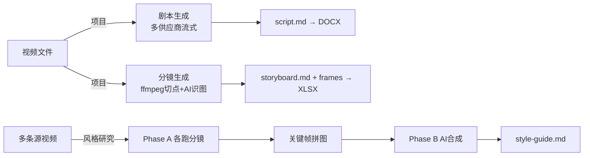

# 包拆拆（XLB Storyboard）需求文档

> 需求规格说明书（SRS） · 从现有实现反推
>
> | 项 | 值 |
> | --- | --- |
> | 产品名 | 包拆拆 / XLB Storyboard |
> | 包名（package.json name） | `v2script` |
> | 版本 | `1.0.4` |
> | appId | `com.xlbstoryboard.app` |
> | productName | `XLB Storyboard` |
> | 文档版本 | 对应代码版本 1.0.4 |
> | 文档定位 | 从现有实现反推的需求规格，作为验收与回归基线 |

本文档以「经源码核实的结构化事实」为唯一事实来源撰写。凡源码未覆盖、无法确认的能力均不写入；文中所有默认值、阈值、上限均与代码一致（已核对 `src/main/services/config.ts` 的 `DEFAULT_CONFIG`）。

---

## 1. 背景与目标

### 1.1 背景

短剧、影视、自媒体编导在「拆解成片」这件事上长期依赖人工：把一条视频逐段记下台词、动作、机位与景别，整理成「剧本」与「分镜表」既费时又难统一格式；研究「爆款风格」时更要把多条参考视频反复观看、归纳共性。市面通用工具要么只做转写、要么只做截图，缺少「视频 → 结构化剧本 + 结构化分镜表 + 可量化风格指南」的一体化桌面方案。

包拆拆（XLB Storyboard）是一款 **本地优先的桌面工具**，把一条视频自动转换为：

- **剧本**：带 `[HH:MM:SS]` 时间戳、按场景切分的文字脚本，可导出 Word（DOCX）。
- **分镜表**：基于画面切点检测 + AI 图像理解，逐镜给出景别 / 角度 / 运镜 / 七段式提示词描述 / 台词 / 音效 + 关键帧，可导出 Excel（XLSX）。
- **风格指南（风格研究 / 蒸馏）**：把多条爆款视频各自拆成分镜，抽取高分关键帧拼图，再由 AI 合成一份结构化《风格指南》Markdown。

### 1.2 产品目标

| 目标 | 说明 |
| --- | --- |
| 自动化拆解 | 让「看片 → 写剧本 / 画分镜」的人工劳动由 AI + ffmpeg 完成大部分 |
| 结构化产出 | 产出可直接交付 / 再编辑的剧本（DOCX）与分镜表（XLSX） |
| 多供应商可选 | 支持 Gemini / Kimi / MiniMax-M3 / 自定义 OpenAI 兼容供应商，用户按成本与可用性自由切换 |
| 本地优先 | 项目、剧本、分镜、关键帧、风格指南全部落盘到本地数据目录，离线可查 |
| 跨平台桌面 | Windows（安装版 + 便携版）、macOS（dmg / zip / mas） |

### 1.3 技术栈与形态（约束性背景）

- 运行时：Electron 33 + electron-vite，主进程 / preload / 渲染进程三进程模型。
- UI：React 18 + TailwindCSS + TypeScript。
- 媒体处理：`ffmpeg-static` / `ffprobe-static` + `fluent-ffmpeg`，做切点检测、截帧、压缩、分段、拼图。
- AI 供应商：Gemini（`@google/genai`）、Kimi（Moonshot REST）、MiniMax-M3（OpenAI 兼容 REST）、自定义 OpenAI 兼容供应商。
- 导出：`docx`（剧本 Word）、`exceljs`（分镜表 Excel）。
- 打包：`electron-builder`，Windows 出 nsis 安装版 + portable 便携版；macOS 出 dmg / zip / mas。

---

## 2. 用户画像与典型使用场景

### 2.1 用户画像

| 画像 | 描述 | 核心诉求 |
| --- | --- | --- |
| 短剧编导 / 编剧 | 需要把竞品成片快速拆成剧本和分镜，做改编或对标 | 快速、结构化、可导出再编辑 |
| 影视 / 广告分镜师 | 把样片整理为标准分镜表，标注景别 / 角度 / 运镜 | 分镜字段规范、关键帧准确、可导出 XLSX |
| 自媒体 / 短视频运营 | 研究多条爆款视频的共同风格，沉淀方法论 | 多视频批量拆解 + 合成《风格指南》 |
| 内容团队 | 需要离线、可控成本、可换供应商的桌面工具 | 本地存储、密钥自管、供应商可切换 |

### 2.2 典型使用场景

**场景 A：把一条成片拆成剧本**

1. 新建项目并选择视频文件。
2. 在播放器旁点击「生成剧本」，选好的供应商上传 / 内联视频并流式生成带时间戳的剧本。
3. 实时查看流式文本与进度，完成后按场景卡片浏览，导出 DOCX。

**场景 B：把一条成片拆成分镜表**

1. 在同一项目里点击「生成分镜」。
2. ffmpeg 按画面差异阈值检测切点、逐帧截图，先铺占位分镜行，再按并发批量调用 AI 图像理解逐镜填充。
3. 在时间轴下方的差异曲线右键可手动加镜；对个别镜头可「重新识别」。完成后导出 XLSX（内嵌关键帧）。

**场景 C：研究爆款风格（蒸馏）**

1. 新建「风格研究」，多选若干源视频。
2. 系统对每条视频各跑一遍分镜（Phase A，按 `video_concurrency` 并发），抽取高分关键帧拼成网格图。
3. 把所有分镜 Markdown + 拼图喂给 AI 流式合成一份四段式《风格指南》（Phase B），可复制 / 下载为 `.md`。



---

## 3. 术语表

| 术语 | 含义 |
| --- | --- |
| 项目（Project） | 一个视频 + 可选剧本 + 可选分镜表 + 场景差异曲线，落盘为一个目录 |
| 剧本（Script） | 带 `[HH:MM:SS]` 时间戳、按场景切分的文字脚本，落盘 `script.md` |
| 场景（ScriptScene） | 由 `parseScript` 从剧本文本切出的一段，含起始秒、标题、正文 |
| 分镜表（Storyboard） | 逐镜的结构化表，落盘 `storyboard.md` + `frames/` |
| 镜头（StoryboardShot） | 一镜，含 number/景别/角度/运镜/七段式提示词描述/台词/音效/时间范围/差异分；内部继续使用 `description` 字段 |
| 切点检测 | ffmpeg 按相邻帧差异值（scene）定位镜头切换点 |
| 场景差异曲线（scene-scores） | 每帧差异值序列，落盘 `scene-scores.json`，用于时间轴可视化与手动加镜 |
| 关键帧（Frame） | 每镜截取的 jpg 图，落盘 `frames/` |
| 风格研究 / 蒸馏（Distillation） | 多视频分镜 → 关键帧拼图 → AI 合成《风格指南》的流水 |
| 子视频（SubVideo） | 风格研究中的一条源视频及其分镜 / 状态 |
| 拼图（Mosaic） | 用 ffmpeg xstack 把高分关键帧拼成 4 列网格的 thumbnail.jpg |
| 风格指南（Style Guide） | 蒸馏 Phase B 合成的四段式 Markdown，落盘 `style-guide.md` |
| 供应商（Provider） | AI 服务：Gemini / Kimi / MiniMax / 自定义 OpenAI 兼容 |
| 作业（Job） | 一次异步生成任务，带 jobId、可取消、推送进度事件 |
| 数据根目录（dataRoot） | 所有项目 / 研究 / 日志的落盘根，按形态解析（见 §6.1） |
| media:// 协议 | 主进程自定义协议，把本地绝对路径以 base64url 编码后供 `<video>/` 加载 |

---

## 4. 功能性需求（FR）

> 优先级：P0 = 核心，缺失则产品不成立；P1 = 重要，影响体验或完整度；P2 = 增强 / 边缘。
> 所有「输入 / 输出」均指经 `window.v2s`（preload contextBridge）转发到主进程 IPC 的调用与返回。

### 4.1 项目管理（PROJECT）

| 编号 | 描述 | 输入 / 输出 | 验收标准 | 优先级 |
| --- | --- | --- | --- | --- |
| FR-PROJ-01 | 创建空项目 | 输入 `{name, videoPath}`；输出 `Project` | 生成 UUID 目录 `projects/<id>/`，原子写 `project.json`；name 为空时回退「未命名项目」 | P0 |
| FR-PROJ-02 | 列出项目 | 无；输出 `Project[]` | 按 `updatedAt` 倒序；并发探测 `script.md`/`storyboard.md` 决定 `hasScript`/`hasStoryboard`；损坏目录静默跳过 | P0 |
| FR-PROJ-03 | 加载项目 | `id`；输出 `Project|null` | 读 `project.json`，不存在 / 损坏返回 null | P0 |
| FR-PROJ-04 | 重命名项目 | `(id, name)`；输出 `Project` | 经 `withMetaLock` 串行 read-modify-write，更新 `updatedAt` | P1 |
| FR-PROJ-05 | 删除项目 | `id`；输出 void | `fs.rm(recursive, force)` 整目录删除 | P1 |
| FR-PROJ-06 | 打开项目目录 | `id` | 调用 `shell` 在系统文件管理器打开项目目录 | P2 |
| FR-PROJ-07 | 导入已有剧本为项目 | 无（弹文件选择）；输出项目 | `importScriptAsProject` 将外部剧本导入为新项目 | P1 |
| FR-PROJ-08 | 导入已有分镜目录为项目 | 无（弹目录选择）；输出项目 | `importStoryboardAsProject` 将外部分镜目录导入为新项目 | P1 |
| FR-PROJ-09 | 元数据持久化原子性 | — | `project.json` 先写 `.tmp` 再 `rename`，崩溃 / 断电不留半截 JSON | P0 |
| FR-PROJ-10 | 沙盒下视频容器化 | — | MAS 沙盒（`process.mas`）下创建项目时把源视频拷入项目目录（`importMediaToContainer`），非沙盒原样引用外部路径 | P1 |

### 4.2 视频导入与播放（VIDEO）

| 编号 | 描述 | 输入 / 输出 | 验收标准 | 优先级 |
| --- | --- | --- | --- | --- |
| FR-VIDEO-01 | 选择单个视频 | 无；输出路径或 null | `file:pick-video` 打开系统文件对话框 | P0 |
| FR-VIDEO-02 | 选择多个视频（风格研究用） | 无；输出路径数组 | `pickVideos` 多选 | P0 |
| FR-VIDEO-03 | 探测视频信息 | `videoPath`；输出 `VideoInfoDto` | 返回 path/durationSec/width/height/sizeBytes/format/videoCodec/audioCodec（ffprobe） | P0 |
| FR-VIDEO-04 | 视频播放（seek） | 经 `media://` 协议 | `<video src=media://local/<base64url>>` 可正常播放并 seek；HTTP Range 支持：<5MB 整文件 200，否则流式 206，非法 Range 返回 416 | P0 |
| FR-VIDEO-05 | 关键帧缩略图加载 | 绝对路径 | `getMediaUrl` 在 preload 同步生成 `media://` URL；渲染层 fetch→blob→objectURL，卸载时 revoke | P1 |

### 4.3 剧本生成（SCRIPT）

| 编号 | 描述 | 输入 / 输出 | 验收标准 | 优先级 |
| --- | --- | --- | --- | --- |
| FR-SCRIPT-01 | 启动剧本生成作业 | `{projectId, videoPath}`；输出 `{jobId}` | 立即返回 jobId（不阻塞），后台 `runJob` 异步执行 | P0 |
| FR-SCRIPT-02 | 按配置选择供应商 | `script_provider` | 值为 `kimi`/`minimax`/已存在的自定义 provider id 时分派对应 service，否则（含已删除 id）回退 Gemini | P0 |
| FR-SCRIPT-03 | 视频预处理与投递 | — | 按各 provider 上限压缩：Gemini 目标 200MB、Kimi `KIMI_MAX_UPLOAD_MB=95`（硬上限 100MB 超出报错）、MiniMax 95MB、自定义内联 `INLINE_MAX_VIDEO_MB=30`；Gemini 走 File API，Kimi/MiniMax 走各自 multipart 上传，自定义走 base64 内联 | P0 |
| FR-SCRIPT-04 | 流式生成并推送进度 | — | 通过 `onToken` 增量回传，`event:progress` 携带 `partialScript`；进度分阶段映射（见 NFR-PERF） | P0 |
| FR-SCRIPT-05 | 强制时间戳格式 | — | system prompt 强制输出 `[HH:MM:SS]` 三段式时间戳 | P0 |
| FR-SCRIPT-06 | 后处理（MiniMax / 自定义） | — | 剥 `<think>`（`stripThinkComplete`）→去代码围栏→空则报错「模型在思考阶段被截断」→时间戳等比缩放（最大时间戳 > 时长+1 才缩放，锚 0） | P1 |
| FR-SCRIPT-07 | Gemini 长视频分段 + 合并 | — | Gemini 是唯一支持长视频 `segmentVideo` 分段生成 + `buildMergePrompt` 合并的供应商；Kimi/MiniMax/自定义均单次整段 | P1 |
| FR-SCRIPT-08 | 场景解析与落盘 | — | `parseScript` 切出 `ScriptScene[]`；`writeScriptMd` 落盘 `script.md`（UTF-8）；落盘失败仅记日志不阻断（scriptPath 可能 undefined） | P0 |
| FR-SCRIPT-09 | 完成 / 失败 / 取消事件 | — | 完成推 `event:completed`(ScriptResult)+`event:project-updated`；失败推 `event:failed`；取消（signal.aborted）推 `cancelled` | P0 |
| FR-SCRIPT-10 | 取消作业 | `jobId`；输出 `{ok}` | `script:cancel` → `AbortController.abort()`；service 在压缩 / 上传 / 等待 / 每个 SSE chunk 处检查信号 | P0 |
| FR-SCRIPT-11 | 上传伪进度 | — | 上传无原生进度时用伪进度定时器（800ms、假设 2MB/s、封顶 0.99） | P2 |
| FR-SCRIPT-12 | 临时文件清理 | — | 作业结束 finally 删除已上传云端文件与压缩临时文件 / 临时目录（均吞错） | P1 |

### 4.4 剧本编辑与导出（SCRIPT-EXPORT）

| 编号 | 描述 | 输入 / 输出 | 验收标准 | 优先级 |
| --- | --- | --- | --- | --- |
| FR-SCRIPTEXP-01 | 场景卡片展示 | — | 按 `\n` 拆分台词 / 动作（△）/ 人物 / 字幕，剥离时间戳前缀；无时间戳时降级为原文 `pre` 展示并提示 | P1 |
| FR-SCRIPTEXP-02 | 导出 DOCX | `projectId`；输出保存路径或 null | `readScriptMd→parseScript→generateScriptDocx`，经保存对话框（默认文件名「剧本.docx」）；durationSec 重新 `getVideoInfo`（视频不存在则为 0，videoPath 置空） | P0 |
| FR-SCRIPTEXP-03 | 流式预览 | — | 生成过程中作业面板实时显示流式剧本文本、token、字数、进度时间线 | P1 |

### 4.5 分镜表生成（STORYBOARD）

| 编号 | 描述 | 输入 / 输出 | 验收标准 | 优先级 |
| --- | --- | --- | --- | --- |
| FR-SB-01 | 启动分镜作业 | `{projectId, videoPath}`；输出 `{jobId}` | `storyboard:start` 立即返回 jobId | P0 |
| FR-SB-02 | 切点检测 | — | 单视频项目用 `detectShotsWithSeries`（整段每帧曲线峰值法，失败回退 `detectShots`）；`detectShots` 用 ffmpeg select+scene 阈值法；切点 <2 时 `postProcessShots` 均匀补帧（上限 `min(maxShots,60)`） | P0 |
| FR-SB-03 | 截帧 | — | `extractFrame` 用 ffmpeg `-ss + scale=854:-2 + -q:v 2` 输出 jpg；文件名 `frame_<round(t*1000) 左补0至8位>.jpg` | P0 |
| FR-SB-04 | 占位脚手架 | — | 截帧完成后一次性下发 `event:storyboard-scaffold` 铺占位分镜行（shotType=识别中…） | P1 |
| FR-SB-05 | AI 图像识别 | — | 按 `concurrency` 分批 `Promise.all` 调用分析器；逐镜推 `event:storyboard-shot-updated`；解析失败正则提取 `{…}` 再 JSON.parse，仍失败用默认字段（近景 / 平视角 / 静态镜头，描述取文本前 200 字） | P0 |
| FR-SB-06 | 供应商可选 | `storyboard_provider` | 默认 gemini，可选 kimi/minimax/openai/自定义 id；Gemini 使用低思考，正式生成不设应用级输出上限；Claude 因 API 必填而使用模型最大输出值；截断或空回答必须报错 | P0 |
| FR-SB-07 | 差异曲线持久化 | — | `scene-scores.json` 写每帧差异曲线（best-effort，失败仅记日志不影响分镜）；曲线降采样上限 `SCENE_SERIES_MAX_POINTS=1500` | P1 |
| FR-SB-08 | 落盘分镜表 | — | 组装 `StoryboardProject` 写 `storyboard.md`（含图片相对引用 `frames/xxx`）+ 推 `event:project-updated` | P0 |
| FR-SB-09 | 取消作业 | `jobId`；输出 `{ok}` | `AbortController` 透传给 ffmpeg（kill 子进程）与 AI 请求；取消静默（分析阶段 catch 中若 aborted 则 return，不落失败态） | P0 |
| FR-SB-10 | 进度推送 | — | `event:storyboard-progress` 携带 status/progress/currentShot/totalShots/threshold/capturedFrame/sceneSeries | P1 |

### 4.6 分镜编辑与导出（STORYBOARD-EDIT）

| 编号 | 描述 | 输入 / 输出 | 验收标准 | 优先级 |
| --- | --- | --- | --- | --- |
| FR-SBEDIT-01 | 增量重新识别 | `{projectId, indices[]}`；输出 `{ok, updated, failed}` | 复用截图重识别选定镜头，仅替换 AI 内容，保留 number/startSec/endSec/timeRange/sceneScore；失败保留旧镜并带 error；`updated>0` 才写盘 | P1 |
| FR-SBEDIT-02 | 手动切点 CRUD | 新增 `{projectId,timeSec}`；移动 `{projectId,index,timeSec}`；删除 `{projectId,index}` | AI 全部识别完成后在帧差异曲线上操作；仅拒绝同毫秒/同帧、首帧和越界，不使用 0.4 秒限制；删除右镜并让左镜吞并区间 | P1 |
| FR-SBEDIT-03 | 人工结果持久化与并发安全 | — | `storyboard-boundary-overrides.json` 保存 forced/suppressed，重切和切换方式不丢；所有增删改、重识别及后台识别按 projectId 串行，避免 lost update | P1 |
| FR-SBEDIT-04 | 缩略图查看 | — | 编辑器内 fetch→blob→objectURL 显示关键帧；framePath 变化 / 卸载时 revoke 并重置错误态 | P1 |
| FR-SBEDIT-05 | 导出 XLSX | `projectId`；输出保存路径或 null | `generateStoryboardXlsx`（exceljs）生成含内嵌关键帧的 xlsx；列：镜号 / 景别 / 角度 / 运镜 / 关键帧 / 时长 / 提示词描述 / 台词 / 音效，行高 180，首行冻结；临时文件 `temp/storyboard-<projectId>.xlsx` 导出后删除 | P0 |
| FR-SBEDIT-06 | 生成中保护与内容保护 | — | 完整 AI 识别完成前禁用切点编辑；移动切点时 `userEdited=true` 的右镜不自动覆盖，显式「重新识别」才允许覆盖并清除标记 | P1 |
| FR-SBEDIT-07 | 时间轴交互 | — | `SceneScoreCurve` 支持点击查询/seek、空白右键新增、切点右键精确移动/删除、首帧锁定，并显示阈值线 / 切点 / 播放头 | P1 |

### 4.7 风格研究 · 蒸馏（DISTILL）

| 编号 | 描述 | 输入 / 输出 | 验收标准 | 优先级 |
| --- | --- | --- | --- | --- |
| FR-DIST-01 | 列出 / 创建 / 加载 / 重命名 / 删除研究 | 各对应 IPC | `distill:list/create/load/rename/delete`；创建 `{name, videoPaths}` 把源视频拷入容器 `videos/`，meta 存容器副本路径 | P0 |
| FR-DIST-02 | 追加源视频 | `(id, videoPaths)` | `addVideosToDistillation` 去重追加；新增视频使旧 `hasStyleGuide` 置 false（风格指南作废） | P1 |
| FR-DIST-03 | 启动蒸馏作业 | `{distillationId}`；输出 `{jobId}` | `distill:start`，立即返回 jobId | P0 |
| FR-DIST-04 | Phase A 多视频分镜 | — | 按 `video_concurrency` 分批并发，对每条视频调 `runStoryboardOnce` 写各自 `storyboard.md` + `sub.json`；单视频失败不终止整体（failed++），仅 `successCount==0` 才整体失败 | P0 |
| FR-DIST-05 | 关键帧拼图 | — | 对每个成功子视频按 `sceneScore` 降序取前 `mosaic_frames_per_video` 张，ffmpeg xstack 拼成 4 列 `thumbnail.jpg`；拼图失败仅记日志不中断 | P1 |
| FR-DIST-06 | Phase B AI 合成 | — | 选 provider，把所有成功分镜 md 拼成 userText、拼图作为 images，流式合成《风格指南》；systemPrompt = `synthesis_prompt` 或默认四段式 prompt；partial 为空抛错 | P0 |
| FR-DIST-07 | 合成 provider 解析 | `synthesis_provider` | null 时继承 `storyboard_provider`，再回退 gemini | P1 |
| FR-DIST-08 | 风格指南落盘 | — | 原子写 `style-guide.md`（.tmp→rename）；若有失败子视频，尾部追加跳过说明；`markHasStyleGuide` + 推 completed/updated | P0 |
| FR-DIST-09 | 取消作业 | `jobId`；输出 `{ok}` | AbortController 贯穿 runStoryboardOnce 与 synthesize；取消走 `event:distill-failed`，message=「已取消」 | P0 |
| FR-DIST-10 | 流式预览与进度 | — | `event:distill-progress` 携带子视频进度与 `partialStyleGuide`；前端可实时预览 | P1 |
| FR-DIST-11 | 查看子分镜 | `{id, subIndex}` | `loadDistillationSubStoryboard` 只读复用分镜编辑器查看子视频分镜 | P2 |
| FR-DIST-12 | 复制 / 下载风格指南 | — | 复制到剪贴板；前端 Blob+download 保存为 `${name||'style-guide'}.md` | P2 |
| FR-DIST-13 | 重启状态恢复 | — | `loadDistillation` 把持久化的 detecting/analyzing 状态复位为 pending（避免 UI 卡转圈） | P1 |

### 4.8 供应商与设置（CONFIG）

| 编号 | 描述 | 输入 / 输出 | 验收标准 | 优先级 |
| --- | --- | --- | --- | --- |
| FR-CFG-01 | 读取配置 | 无；输出 `AppConfig` | `config:get` 返回 cachedConfig（首次 loadConfig 读 `config.yaml`） | P0 |
| FR-CFG-02 | 保存配置 | `AppConfig`；输出 `{ok:true}` | `config:set` 保存 YAML（indent:2 lineWidth:120）+ 注入全局 fetch 代理；mergeConfig 做范围钳制 | P0 |
| FR-CFG-03 | 范围钳制 | — | `scene_threshold` 钳制 0.01..1；`video_concurrency` 钳制 1..4；`mosaic_frames_per_video` 钳制 1..12；`concurrency` 强制 clamp 到 [1,10]（运行期）；`max_shots`/`concurrency` 在 merge 仅 `??` 默认回退（见已知问题 KI-01） | P1 |
| FR-CFG-04 | 测试连接 | provider 配置 | `config:test-connection`（Gemini）/ `config:test-storyboard-connection`（按 provider 分派）/ `config:test-kimi` / `config:test-minimax` / `config:test-custom-provider`；返回 `{ok, message, models?}` | P1 |
| FR-CFG-05 | 自定义供应商管理 | — | 设置弹窗可增删自定义 OpenAI 兼容供应商（id/name/api_key/base_url/model）；删除时 `script_provider`/`storyboard_provider` 回退 gemini、`synthesis_provider` 回退 null | P1 |
| FR-CFG-06 | 功能参数配置 | — | 设置可改：剧本 / 分镜 provider、`scene_threshold`（0.01~1 步进 0.01）、`max_shots`（UI 10~500）、`concurrency`（UI 1~10）、分镜 prompt、蒸馏并发 / 拼图帧数 / 合成 provider / 合成 prompt | P1 |
| FR-CFG-07 | 代理配置 | `gemini.proxy` | 留空跟随系统代理（`session.resolveProxy`），仍无则直连；SOCKS 不支持→直连；优先级：显式 proxy > 系统代理 > 直连 | P1 |
| FR-CFG-08 | 窗口控制 | — | `window:close` / `window:minimize`；窗口控制按钮仅在 Windows 平台渲染 | P2 |

#### 默认配置（与 `config.ts` 的 `DEFAULT_CONFIG` 一致）

```yaml
gemini:
  api_key: ''
  model: gemini-3-flash-preview      # video_resolution: low|high
  video_resolution: low
  proxy: ''
kimi:
  api_key: ''
  model: kimi-k3                      # base_url 留空回退 https://api.moonshot.cn/v1
  base_url: ''
minimax:
  api_key: ''
  model: MiniMax-M3                   # base_url 留空回退 https://api.minimaxi.com/v1
  base_url: ''
custom_providers: []
script_provider: gemini
storyboard_provider: gemini
storyboard:
  prompt: ''                          # 留空用 STORYBOARD_DEFAULT_PROMPT
  scene_threshold: 0.3                # 钳制 0.01..1
  max_shots: 200
  concurrency: 3                      # 运行期 clamp 1..10
distillation:
  video_concurrency: 2               # 钳制 1..4
  synthesis_provider: null            # null = 继承 storyboard_provider
  mosaic_frames_per_video: 6          # 钳制 1..12
  synthesis_prompt: ''                # 留空用 DISTILLATION_DEFAULT_PROMPT
```

> 说明：Kimi 默认模型和渲染层回退值均为 `kimi-k3`；下拉预设只保留 K3 与 K2.7 系列。

---

## 5. 非功能性需求（NFR）

### 5.1 性能与并发

| 编号 | 需求 | 验收标准 |
| --- | --- | --- |
| NFR-PERF-01 | 分镜分析并发可控 | `storyboard.concurrency` 控制单视频内 AI 分析并发，运行期 clamp 到 [1,10]，默认 3 |
| NFR-PERF-02 | 蒸馏多视频并发可控 | `distillation.video_concurrency` 控制 Phase A 并发，钳制 1..4，默认 2；按批 `Promise.all`（批间串行） |
| NFR-PERF-03 | 进度阶段映射 | 剧本：preparing 0.05 / compressing 0.1 / uploading 0.18 / waiting_process 0.32 / generating 0.42 / merging 0.92；生成阶段按 `acc.length/4000` 估算封顶 0.95。分镜：detecting 0.05-0.15 / capturing 0.15-0.45 / analyzing 0.45-0.90 / saving 0.92 / completed 1 |
| NFR-PERF-04 | 长视频分段 | video.ts：`SEGMENT_THRESHOLD_SEC=2h`、`SEGMENT_DURATION_SEC=30min`、`SEGMENT_OVERLAP_SEC=30s`；分镜压缩 `maxMB=50→scale=854:-2,fps=2,crf32,veryfast` |
| NFR-PERF-05 | 媒体流式服务 | `media://` 小于 5MB 整文件读，否则 `createReadStream + Readable.toWeb` 流式，支持 Range，避免大文件全量进内存 |
| NFR-PERF-06 | 曲线降采样 | 场景差异曲线降采样上限 1500 点，渲染用 useMemo 缓存几何，播放头高频刷新不重算折线 |

### 5.2 可靠性（取消 / 容错 / 部分失败）

| 编号 | 需求 | 验收标准 |
| --- | --- | --- |
| NFR-REL-01 | 作业可取消 | 三类作业（剧本 / 分镜 / 蒸馏）均一作业一 AbortController，cancel 立即 abort；窗口关闭触发三个 manager `cancelAll()` |
| NFR-REL-02 | 取消区分终态 | 区分 cancelled 与 failed（据 `signal.aborted`）；取消不污染日志 / 不落失败态 |
| NFR-REL-03 | 部分失败容错 | 蒸馏单子视频失败不终止整体，仅 `successCount==0` 才整体失败；单拼图失败不影响合成 |
| NFR-REL-04 | 检测回退链 | `detectShotsWithSeries` 失败回退 `detectShots`；切点不足均匀补帧；AI 解析失败用默认字段兜底 |
| NFR-REL-05 | 持久化容错 | `readMeta/readScriptMd/readSceneScores/listProjects` 损坏静默降级（null/[]），单损坏项目不影响整体 |
| NFR-REL-06 | 元数据原子写 + 串行 | `project.json`/`style-guide.md` 用 `.tmp→rename` 原子写；renameProject/touchProject 经 `withMetaLock` 串行 |
| NFR-REL-07 | 启动鲁棒性 | 配置 / 代理初始化包 try/catch 不阻塞建窗；`uncaughtException`/`unhandledRejection` 仅记日志不退出 |
| NFR-REL-08 | 空内容防御 | 各 provider 流结束若内容为空抛错；MiniMax / 自定义剥思考后为空抛「模型在思考阶段被截断」 |

### 5.3 安全与隐私

| 编号 | 需求 | 验收标准 |
| --- | --- | --- |
| NFR-SEC-01 | 进程隔离 | BrowserWindow 开启 `contextIsolation`、关闭 `nodeIntegration`，能力经 preload contextBridge 暴露为 `window.v2s` |
| NFR-SEC-02 | 密钥本地存储 | API Key 仅存于本地 `config.yaml`，不上传到产品方服务器；用户自管 |
| NFR-SEC-03 | 视频外发知情 | 视频会被上传 / 内联到用户所选第三方 AI 供应商（Gemini File API / Kimi / MiniMax / 自定义）；MiniMax 端 7 天自动过期；作业结束尽力删除云端文件 |
| NFR-SEC-04 | 本地优先存储 | 项目 / 剧本 / 分镜 / 关键帧 / 风格指南 / 日志全部落盘到本地数据根目录，离线可查 |
| NFR-SEC-05 | 媒体协议受控 | `media://` 仅解码 base64url 本地路径并 stat 后读取，防御性裁剪 Range |

### 5.4 可用性

| 编号 | 需求 | 验收标准 |
| --- | --- | --- |
| NFR-USE-01 | 流式可见 | 剧本 / 风格指南 / 分镜流 / 截图采样边到边累积展示 |
| NFR-USE-02 | 任务抽屉 | 底部抽屉分剧本 / 分镜 / 研究三 tab，可选当前作业、清空已完成、折叠 |
| NFR-USE-03 | preload 守卫 | `PreloadGuard` 轮询 `window.v2s`（100ms / 超时 5s），缺失显示错误页 |
| NFR-USE-04 | 供应商标签快照 | 启动作业前把「将使用 / 本次使用 Provider · model」写入作业卡 |
| NFR-USE-05 | 布局可调 | 可折叠侧栏（宽度 clamp 150~400，折叠 48）、可拖拽分栏、开机动画 |

### 5.5 跨平台

| 编号 | 需求 | 验收标准 |
| --- | --- | --- |
| NFR-CROSS-01 | Windows 安装版 | electron-builder 出 nsis 安装版，数据根 = 安装目录/data（不可写或盘符根回退 userData/data） |
| NFR-CROSS-02 | Windows 便携版 | portable 数据根 = `<exe目录>/XLB Storyboard/data`（不可写回退 userData/data），定位用 `PORTABLE_EXECUTABLE_DIR` |
| NFR-CROSS-03 | macOS | 出 dmg/zip/mas；打包数据根 = userData/data；MAS 沙盒下视频容器化拷贝 |
| NFR-CROSS-04 | ffmpeg 解包 | `ffmpeg-static`/`ffprobe-static` 路径把 `app.asar` 替换为 `app.asar.unpacked` 以在打包后可执行 |

### 5.6 网络与代理

| 编号 | 需求 | 验收标准 |
| --- | --- | --- |
| NFR-NET-01 | 代理注入 | `installGlobalFetch(proxy)` 用 undici ProxyAgent 替换全局 fetch；优先级 显式 proxy > 系统代理 > 直连 |
| NFR-NET-02 | 不用 Electron net.fetch | 流式上传会 `ERR_INVALID_ARGUMENT`；也不用 Node 内置 fetch（与 npm undici 不同实例致代理失效） |
| NFR-NET-03 | SSE 兼容 | 按 `\r\n\r\n|\n\n` 切事件（兼容 CRLF/LF），buffer 保留不完整尾段防 TCP 分包丢 token，`[DONE]` 结束 |

### 5.7 可维护性

| 编号 | 需求 | 验收标准 |
| --- | --- | --- |
| NFR-MAINT-01 | 单一契约源 | 三方共享类型 / IPC 通道常量 / 默认值集中在 `src/shared`，避免硬编码漂移 |
| NFR-MAINT-02 | 诊断日志 | `createLogger(scope,id)` 写 `<dataRoot>/logs/<scope>-<id>.log`，错误信息附带日志路径透出到 UI |
| NFR-MAINT-03 | 纯函数可测 | `parseScript`、`script-postprocess`、`runStoryboardOnce` 为无状态可复用纯函数 |

---

## 6. 数据需求（持久化格式与保留）

### 6.1 数据根目录解析（`getDataRoot()`）

| 形态 | 数据根 |
| --- | --- |
| 开发（dev） | `<appPath>/data` |
| macOS 打包（含 MAS） | `<userData>/data` |
| Windows portable | `<PORTABLE_EXECUTABLE_DIR>/XLB Storyboard/data` |
| Windows 安装 / 解压 | `<安装目录>/data` |
| 回退（不可写 / 盘符根） | `<userData>/data` |

`config.yaml` 位于 `dirname(getDataRoot())`，即数据根的父目录。可写性用写探测文件（`.v2s-write-test`）判断。

### 6.2 磁盘目录布局

```
<dataRoot>/
├── config.yaml 的父目录在 dataRoot 上一级；config.yaml ≈ <exe>/XLB Storyboard/config.yaml 或 <userData>/config.yaml
├── projects/<uuid>/
│   ├── project.json        # ProjectMeta，原子写，2 空格缩进 UTF-8
│   ├── script.md           # 剧本纯文本 UTF-8（可选）
│   ├── storyboard.md       # 分镜表 Markdown（可选）
│   ├── scene-scores.json   # 场景差异曲线，紧凑 JSON（可选）
│   └── frames/             # 关键帧 jpg（可选）
├── storyboards/<id>/       # 另一套并存分镜持久化（storyboard-storage，疑似遗留路径，见 KI-03）
├── distillations/<id>/
│   ├── project.json        # DistillationMeta
│   ├── style-guide.md      # 合成结果，原子写
│   └── videos/<n>_<safeName>/
│       ├── storyboard.md
│       ├── frames/frame_*.jpg
│       ├── thumbnail.jpg   # 4 列拼图
│       └── sub.json        # DistillationSubVideo 状态（真实来源）
└── logs/<scope>-<id>.log   # 诊断日志（追加写）
```

临时导出：`app.getPath('temp')/storyboard-<projectId>.xlsx`，保存后删除。

### 6.3 关键数据结构

| 结构 | 关键字段 |
| --- | --- |
| `ProjectMeta`（project.json） | id, name, videoPath, createdAt(ms), updatedAt(ms) |
| `Project`（对外） | ProjectMeta + hasScript, hasStoryboard |
| `ScriptResult` | jobId, videoPath, durationSec, script, scenes[], generatedInMs, generatedAt, scriptPath? |
| `ScriptScene` | charStart, charEnd, startSec, heading, body, number |
| `StoryboardShot` | number, shotType（六档）, angle, cameraMove, description（固定七行提示词描述）, dialogue, sound, timeRange, startSec, endSec, sceneScore(0-1，首帧 0), userEdited? |
| `StoryboardProject` | id, videoPath, createdAt, shots[], framePaths[] |
| `SceneScoreData` | threshold, durationSec, points[{t,score}] |
| `DistillationMeta` | id, name, videoPaths[], createdAt, updatedAt, hasStyleGuide |
| `DistillationSubVideo` | videoPath, videoName, status, progress, message, shots, errorMessage?, storyboardPath?, thumbnailPath? |
| `AppConfig` | gemini/kimi/minimax/custom_providers/script_provider/storyboard_provider/storyboard/distillation |

`storyboard.md` 字段含：源视频（basename）、生成时间、总镜头数、每镜 `## 镜 N | timeRange`、景别 / 角度 / 运镜、开始时间（HH:MM:SS）、起始秒 / 结束秒（toFixed(3)）、场景差异（toFixed(4)，仅 score>0）、关键帧引用、提示词描述（固定七行 fenced text 块）/ 台词 / 音效；旧 `**描述**` 单行兼容读取。

### 6.4 数据保留

| 数据 | 保留策略 |
| --- | --- |
| 项目 / 研究 / 剧本 / 分镜 / 关键帧 / 风格指南 | 永久本地保留，直到用户删除（`fs.rm recursive`） |
| 上传到云端的视频 | 临时存在，作业结束尽力删除；MiniMax 端 7 天自动过期 |
| 临时导出 / 压缩文件 | 导出 / 作业结束后清理（部分异常路径可能残留，见 KI-02） |
| 诊断日志 | 追加写入 logs 目录，无自动清理 |
| 配置缓存 | `cachedConfig` 单例，运行中不重读盘（外部改 config.yaml 需重启感知，见 KI-04） |

---

## 7. 外部依赖与约束

| 依赖 | 用途 | 约束 |
| --- | --- | --- |
| Gemini（`@google/genai`） | 剧本 / 分镜 / 合成 | File API 上传；唯一支持长视频分段；单段压缩目标 200MB（硬编码）；低思考，不设应用级输出上限 |
| Kimi（Moonshot REST） | 剧本 / 分镜 / 合成 | `/v1/files`（purpose=video）上传，`ms://{id}` 引用；上传上限 95MB（硬上限 100MB）；K3 深度思考 + Partial Mode，不设应用级输出上限；不分段、不缩放时间戳 |
| MiniMax-M3（OpenAI 兼容 REST） | 剧本 / 分镜 / 合成 | `/v1/files/upload`（purpose=video_understanding），`mm_file://{id}` 引用；上限 95MB，不设应用级输出上限；剥 think + 时间戳缩放；云端 7 天过期 |
| 自定义 OpenAI 兼容供应商 | 剧本 / 分镜 / 合成 | 视频 base64 内联 data URL，内联上限 30MB；不设应用级输出上限；剥 think + 时间戳缩放 |
| ffmpeg-static / ffprobe-static | 切点检测 / 截帧 / 压缩 / 分段 / 拼图 / 探测 | 打包需 unpack（app.asar.unpacked）；二进制随包分发 |
| undici | fetch + ProxyAgent | 必须与各 service 同一实例，代理才生效 |
| docx / exceljs | 剧本 DOCX / 分镜 XLSX 导出 | — |
| Electron 33 | 桌面运行时 | 自定义协议、session 代理解析、contextBridge |
| 网络 | 调用第三方 AI | 需可达对应 API 域名；可配代理；SOCKS 不支持 |

---

## 8. 范围外（Out of Scope）

以下能力在当前版本（1.0.4）**不提供**，源码中无对应实现，不应作为需求：

- 云端账号体系、登录、云同步、协作多端共享。
- 产品方托管的 AI 服务 / 代理转发；所有 AI 调用直连用户配置的第三方供应商。
- 视频剪辑 / 转码导出成片、字幕烧录、音频转写（whisper 等本地转写）。
- 剧本 / 分镜内容的富文本在线协同编辑（仅本地结构化展示与导出）。
- 作业失败的自动重试（job-manager 本身无重试逻辑）。
- 运行中热加载 config.yaml（修改需重启）。
- 移动端 / Web 端版本。
- 对 Kimi 路径的长视频分段与时间戳缩放（仅 Gemini 分段、MiniMax / 自定义缩放）。

---

## 9. 验收标准汇总

### 9.1 P0 核心验收（必须全部通过）

1. 新建项目并选择视频后，能正常播放并 seek（`media://` Range 生效）。
2. 切换四类供应商（Gemini/Kimi/MiniMax/自定义）均能成功生成带 `[HH:MM:SS]` 时间戳的剧本并落盘 `script.md`、导出 DOCX。
3. 生成分镜：ffmpeg 检测切点 + 截帧 + AI 逐镜识别，落盘 `storyboard.md` + `frames/`，导出含内嵌关键帧的 XLSX。
4. 风格研究：多视频 Phase A 并发分镜（部分失败可容错）+ 拼图 + Phase B 合成 `style-guide.md`。
5. 三类作业均可取消，取消立即终止并区分 cancelled / failed；窗口关闭全部取消。
6. 配置读写持久化到 `config.yaml`，重启后保留；密钥仅本地存储。
7. 项目元数据原子写，崩溃 / 断电不留半截 JSON，损坏目录不影响列表。
8. Windows 安装版 / 便携版、macOS 三形态数据根目录按 §6.1 正确解析并可写（不可写正确回退 userData/data）。

### 9.2 P1 重要验收

1. 增量重新识别仅替换 AI 内容并保留时序字段；手动加镜按时间插入并后台补全。
2. 进度事件分阶段映射，流式文本 / 分镜流 / 截图采样实时可见。
3. 范围钳制生效（scene_threshold 0.01..1、video_concurrency 1..4、mosaic 1..12、concurrency 1..10）。
4. 各 provider 连接测试返回 `{ok, message, models?}`。
5. 代理优先级（显式 > 系统 > 直连）与 SSE CRLF/LF 兼容。
6. 差异曲线持久化与时间轴交互（点击 seek / 右键加镜）。
7. 蒸馏重启后 detecting/analyzing 状态复位为 pending。

### 9.3 P2 增强验收

1. 打开项目 / 研究目录、复制 / 下载风格指南、查看子分镜。
2. 任务抽屉折叠 / 清空、布局拖拽、开机动画、窗口控制按钮（仅 Windows）。

### 9.4 已知问题（记录备查，非本版本必须修复）

| 编号 | 严重度 | 描述 |
| --- | --- | --- |
| KI-01 | medium | `mergeConfig` 中 `storyboard.max_shots`/`concurrency` 仅 `??` 回退，未做类型 / 范围校验，config.yaml 写入非法值会原样进入（concurrency 另在运行期 clamp 1..10） |
| KI-02 | medium | 临时 xlsx 路径不含随机后缀，同项目并发导出会互覆盖；generateStoryboardXlsx 抛错时临时文件可能残留 |
| KI-03 | medium | 存在 `projects/<id>/` 与 `storyboards/<id>/` 两套并存分镜持久化，后者疑似遗留路径，易混淆数据位置 |
| KI-04 | low | `cachedConfig` 单例运行中不重读盘，外部改 config.yaml 需重启才感知 |
| KI-05 | medium | 蒸馏 `buildSynthesisUserText` 全量拼接所有分镜 md + 全部拼图，无长度 / token 上限，视频多时可能触发 provider 上下文超限 |
| KI-06 | medium | Kimi 路径 `tokensUsed` 基本无法上报；MiniMax / 自定义最终 usage chunk delta 为空也难推送最终 token 数 |
| KI-07 | low | `parse-script.ts` HEADING_REGEX 对 CRLF 文本（行尾残留 `\r`）可能匹配失败，宽松匹配也可能把正文时间样式行误判为场景头 |
| KI-08 | low | `deleteProject` 未走 `withMetaLock`，与并发 touchProject 存在「已删项目复活」竞态 |
| KI-09 | low | `media-import` 按文件体积弱去重，字节数恰好相同的不同视频会被误判为同一文件 |
| KI-10 | low | SettingsModal 的 ApiTab 直接读 `draft.minimax.*` 无可选链，旧 config 缺 minimax 字段时打开设置可能抛错（依赖 getConfig 补齐默认值兜底） |

---

> 本文档基于「经源码核实的结构化事实」撰写，并已核对 `src/main/services/config.ts` 的默认值。文中默认值、阈值、上限、路径与 1.0.4 代码一致；未覆盖或无法从源码确认的能力一律未写入。
